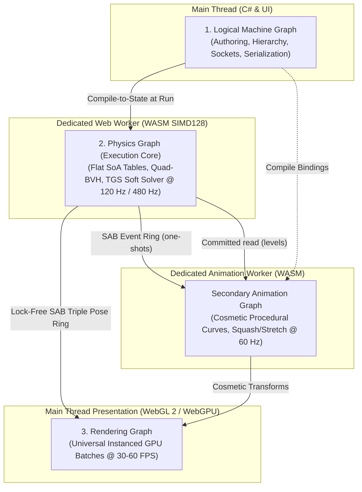

# Architecture Spine — Curious Contraptions Engine

## Design Paradigm

The engine decouples authoring, simulation, and presentation into three independent graphs with strictly one-way data flow:



### 1. Logical Scene / Machine Graph (Main Thread)
Hierarchical authoring representation manipulated by the player in build mode. C# objects manage entity trees, sockets, wiring, placement bounding boxes, and JSON serialization. When the player clicks **Run**, this graph compiles atomically into a flat, contiguous, SIMD-aligned state snapshot.

### 2. Physics Graph (Dedicated Simulation Worker)
A single homogeneous scene record executing in WebAssembly SIMD128 (`wasm-simd128`) on a dedicated Web Worker at 120 Hz (4 sub-steps of rational $h = 1/480\text{ s}$). Advanced by **one generic solver**. No puzzle element possesses its own solver, kernel branch, or per-tick loop. New elements are added purely via declaration data.

### 3. Secondary Animation Graph (Dedicated Animation Worker)
Cosmetic evaluators running at 60 Hz on an independent WebAssembly Web Worker, evaluating procedural curves, squashes, stretches, and light transitions. Fed one-way by two channels that never substitute for each other: one-shot occurrences from the event ring, each consumer with its own cursor, and level states (activation level, latch memory, timer phase, electrical level) read from committed state. It never writes back into physical authority.

### 4. Rendering Graph (Browser Main Thread)
Samples read-only committed poses from a lock-free pre-allocated `SharedArrayBuffer` triple pose ring using shortest-arc quaternion Slerp interpolation. Issues instanced draw calls (`gl.drawElementsInstanced` in WebGL 2, `renderPass.drawIndexed` in WebGPU) grouped by `(MeshID, PipelineID)`. Eliminates GPU readback stalls (`mapAsync` is completely eradicated).

---

## Invariants & Rules

### AD-01 — Tri-Graph Decoupling & One-Way Data Flow
- **Binds:** `all`
- **Prevents:** Circular dependencies, GPU readback stalls, coupling between cosmetic animation and physical truth, frame rate dependencies in solver outcomes.
- **Rule:** Data flows strictly one-way: `Machine Graph -> Physics Graph -> Pose Ring -> Rendering Graph` and `Physics Graph -> Animation Graph -> Rendering Graph`. Neither animation nor rendering may mutate physical simulation state. Physics advances at fixed 120 Hz (480 Hz substeps); animation evaluates at 60 Hz; rendering follows display refresh (30–60 FPS).

### AD-02 — Strictly Zero External Physics Dependencies
- **Binds:** Physics solver, collision detection, and spatial partitioning.
- **Prevents:** Bloat, external license mismatches, non-deterministic WASM runtime divergence, hidden CPU fallback loops, black-box solver bugs.
- **Rule:** The engine relies on **zero external physics libraries** (no Box2D, no Jolt, no Rapier, no PhysX; zero npm/NuGet physics packages). All algorithms, vector mathematics, BVH hierarchies, and constraint solvers are 100% custom, in-engine C# and TypeScript code incorporating modern best-practice patterns.

### AD-03 — Jolt-Inspired Modern Engine Architectural Patterns
- **Binds:** Physics Graph execution core.
- **Prevents:** O(N^2) collision bottlenecks, discrete tunneling at high velocities, solver jitter, solver non-determinism, and GC pressure.
- **Rule:** The in-engine physics core implements:
  1. **4-Wide SIMD Quad-BVH:** Transposed child AABBs evaluated concurrently via `f32x4` min/max and bitmask extraction ($O(\log_4 N)$ traversal).
  2. **Dual-Tree Broadphase:** Separate Static Quad-BVH (zero per-tick refits) and Dynamic Quad-BVH (velocity-fattened AABBs).
  3. **Speculative Contacts CCD:** High-speed anti-tunneling via speculative margin $d_{\text{spec}} = |\mathbf{v}_{\text{rel}} \cdot \mathbf{n}| \, h + s_{\text{slop}}$ and target velocity absorption $v_{\text{target}} = -g/h$, avoiding expensive continuous swept tests.
  4. **4-Point Area-Maximizing Manifold Reduction:** Constant-size 4-point contact manifolds (deepest point, furthest point, and two points maximizing quad area) for deterministic SIMD evaluation.
  5. **Unified Compliant Soft Constraints (TGS Soft):** Box2D v3 Temporal Gauss-Seidel Soft Step with compliance $\gamma$, softness $\beta$, effective mass $M_{\text{eff}}$, and packed 32-bit `FeatureId` warm-starting.
  6. **Disjoint Set Union (DSU) Island Partitioning & Sleeping:** Independent simulation islands; islands sleep when linear speed $< 0.01\text{ m/s}$ and angular speed $< 0.02\text{ rad/s}$ for $> 0.5\text{ s}$ (0 ms cost).
  7. **Zero-Allocation TempAllocator:** All per-substep contact pairs and manifold points allocate from pre-allocated linear bump memory reset per tick. Zero Web Worker garbage collection.
  8. **Symplectic Euler Multi-Substepping:** 480 Hz integration (4 substeps of $h = 1/480\text{ s}$) with per-substep quaternion normalization via fast inverse square root.
  9. **Deterministic Pair Sorting:** Contact pairs sorted strictly by $(\min(A, B), \max(A, B), \text{FeatureId})$ guaranteeing bitwise identical outcomes regardless of worker scheduling.
  10. **64-Byte Cache-Line Aligned Memory:** Contiguous flat Structure-of-Arrays (SoA) layout aligned to 64-byte boundaries.

### AD-04 — Universal Web Graphics Authority (WebGL 2 and WebGPU)
- **Binds:** Presentation pipeline.
- **Prevents:** Fragmentation across browser versions, dependence on bleeding-edge GPU shader flags (e.g. `shader-f16`), platform lockout.
- **Rule:** The game runs universally on both WebGL 2 and WebGPU. Simulation resides in WASM SIMD, completely independent of the GPU graphics pipeline. Instanced draw batches draw hundreds of puzzle elements in 1–2 GPU draw calls.

### AD-05 — Forward-Only Refactoring & Zero Backwards Compatibility
- **Binds:** `all`
- **Prevents:** Code bloat, legacy shims, parallel buggy execution modes, dead code retention.
- **Rule:** Every story names the legacy it deletes and deletes it in the same story (owner, 21 Oct 2026); no mixed old and new path outlives the story that introduces the new one, and every deleted symbol returns 0 production hits. Strictly no backwards-compatibility shims, adapters, wrappers, fallback branches, legacy feature flags, dual-path loaders or automatic migrations are permitted. Wire, save, trace and bundle formats carry no version field or version check; bad input is rejected by structural validation (owner, 21 Oct 2026). When an existing puzzle element is converted to its `elements/<Name>/` package and `.tscn` scene, its per-element records, tables, factories, panels and curves are deleted in that conversion. Git history is the permanent archive.

### AD-06 — Data-Driven Declarative Puzzle Elements
- **Binds:** Catalogue elements (`CAT-001` through `CAT-072`).
- **Prevents:** Element-specific solver branching, bespoke equation tables, individual element tick loops, and regression fragility.
- **Rule:** A new puzzle element is defined strictly by declaration data in its own `elements/<Name>/` package: the element's Godot `.tscn` scene with visual meshes, co-located collision proxies (`col_*`) and 3D socket locators (`Loc_Port_<Id>`), plus mass, inertia, material coefficients, constraint parameters, force regions, energy stores, typed parameters and animation bindings. No code outside `elements/` (the compiler, the solver, both workers, authoring, UI, presentation, persistence and tools alike) contains an element-specific `switch`, class reference, record type, `is`/`PartId` arm or special-case branch. Any developer adding an element authors its package only; the engine, the general WASM SIMD physics core and the animation worker remain untouched. Codebase greps for element or level identifiers outside `elements/` must return 0 matches. Stories 9A.45a (ratchet) and 9A.45 (final gate) enforce this rule; until then the [isolation authority's Current status](../../docs/architecture/element-package-isolation.md#current-status) lists every remaining violation with its owner.

### AD-07 — Game-Grade Numerical Envelope
- **Binds:** Physical arithmetic and solver updates.
- **Prevents:** Tick faults, browser panics, unhandled NaN crashes during edge-case constructions.
- **Rule:** Clamp or continue:
  - Resting penetration $\le 0.5\text{ mm}$; temporary penetration resolved via compliant $\gamma$.
  - Linear velocity clamped to $\le 64\text{ m/s}$; angular velocity clamped to $\le 128\text{ rad/s}$.
  - Non-finite numbers (NaN/Inf) discard candidate state and preserve last committed pose without terminating the tick.
  - Quaternion renormalized every substep ($\|\mathbf{q}\| - 1 \le 10^{-4}$).

### AD-08 — Strict Enum Typing and C# Domain Boundaries
- **Binds:** Domain logic, APIs, event contracts, persistence formats.
- **Prevents:** Stringly-typed logic bugs, parse errors, loose object mapping.
- **Rule:** Closed sets are enums end-to-end. Extensible identities (specifically puzzle elements and components) use strongly typed ids issued by the loaded element bundle; closed enums and named element constants are prohibited for puzzle elements. Validated string conversion occurs only at genuine external boundaries (JSON import/export, UI labels). Domain logic must not use named string constants or `nameof`/string matching for control flow.

### AD-09 — Exact Lifecycle Restoration & Deterministic Save/Load
- **Binds:** Level lifecycle, Workshop state, persistence.
- **Prevents:** Simulation drift between runs, dirty reset states, corrupted save files.
- **Rule:** Pressing **Reset** restores the exact authoring construction and typed connections. Saving during **Run** is rejected. Save and Load preserve exact IEEE-754 `f32` bit patterns and configurations.

### AD-10 — Paired Subagent Engineering with Independent Adversarial Verification
- **Binds:** Development and review workflows.
- **Prevents:** Blind self-approval, missed regressions, unverified assumptions, broken builds in main.
- **Rule:** Every INVEST vertical slice is implemented by a dedicated Implementation Subagent and verified by a distinct, independent Adversarial Review Subagent. Each candidate passes the [verification tiers](autonomous-development-guide.md#verification-tiers). Review requires:
  - Exact diff inspection and requirement mapping.
  - Zero superseded code remaining (AD-05).
  - Tier 1 on every candidate: `dotnet build CuriousContraptions.slnx` with 0 warnings and the C# static gate, `dotnet test CuriousContraptions.slnx` at 100%, the `tools/*.test.mjs` harnesses and contract checks, and `anvil check --changed` with 0 warnings.
  - Tier 2 for every story: the story's own `tools/e2e/<suite>.test.ts` and the impact-selected suites in actual Chrome via the Playwright connector, run by `tools/E2eRunner`, passing 100%, including exact Reset and Save/Load in Chrome.
  - Tier 3, the full run, only for a material engine change or a checkpoint (timing-sensitive suites alone, the rest on parallel workers).

### AD-11 — Element Scenes and the Element Bundle
- **Binds:** Visual meshes, collision geometry, socket anchors, and catalogue loading.
- **Prevents:** Hardcoded C# geometry tables, procedural mesh generation, a second catalogue authority, manual part registration.
- **Rule:**
  1. **The element's `.tscn` scene (owner decision, 18 Oct 2026):** Every puzzle element authors its visual meshes (PBR materials per DESIGN.md) and its physical collision proxies in its own Godot `.tscn` scene inside its `elements/<Name>/` package. Visual nodes and collider nodes are separate. Collider nodes are dedicated physics proxies (`col_box`, `col_sphere`, `col_capsule`, `col_cylinder`, `col_hull`) whose rendering is suppressed. Collider extraction reads only the dedicated proxy nodes, with zero element branching; under Story 9A.16 it runs at build time and its output is baked into the bundle.
  2. **Socket Locators (`Loc_Port_<Id>`):** Authored as empty locator nodes in the scene, named exactly by the declared typed socket. Wires and cables snap to these locators, tracking articulated child transforms automatically.
  3. **The element bundle is the sole catalogue source:** `tools/BundleElements` discovers every `elements/*` package at build time and writes one bundle with one schema and no version field ([bundle schema contract](../../docs/engine-contracts.md#element-bundle-schema-contract)). At start-up `PartRegistry` loads only that bundle; a missing or structurally invalid bundle stops start-up with an explicit message. Generic `MachinePart` entities are instantiated from bundle entries without per-element code. The retired catalogue and its replacement stories are listed in the [isolation authority's Current status](../../docs/architecture/element-package-isolation.md#current-status).
  4. **No code-defined geometry:** Procedural mesh generation and hardcoded collider tables are forbidden; the remaining collider tables are deleted by Story 9A.16.

### AD-12 — Multi-Domain Port Compatibility & Physical Conservation
- **Binds:** Connection graph and multi-domain solver stages.
- **Prevents:** Incompatible port wiring, unphysical loops, instantaneous signal deadlocks.
- **Rule:**
  1. Connections validate on domain equality ($\text{Domain}_{\text{src}} == \text{Domain}_{\text{dst}}$) and directional pairing (Exposed `Output` $\to$ Accepted `Input`).
  2. Directed unbuffered activation networks reject cycles during graph compilation unless a stateful delay is present.
  3. Energy conservation holds strictly: loads cannot extract more power than available in finite work stores or supply networks.

### AD-13 — Sole Architecture
- **Binds:** `all`
- **Prevents:** Parallel design routes, end states described as already true, legacy that survives its replacement.
- **Rule:** The [element package isolation authority](../../docs/architecture/element-package-isolation.md) is the sole design authority. The only permitted design is:
  1. **Project per element:** each `elements/<Name>/` package is its element's only declaration and references only the Abstractions;
  2. **Command/query:** every mutation is a typed, sequenced command with a receipt through `WorkshopCommandRouter`; reads are the committed read model (`WorkshopRead`), the pose ring and typed queries;
  3. **Event disruptor:** one-shot occurrences travel only on the single-producer, multi-consumer event ring; level states are committed-state queries.

  The owner rules bind every story: no fixed capacities (every table is sized from the scene); no wire, save, trace or bundle format versioning (structural validation rejects bad input); each story deletes the old code it supersedes in the same story; and every candidate passes the [verification tiers](autonomous-development-guide.md#verification-tiers). The authority's **Target invariants** state the design; its **Current status** is the only place that lists where the tree falls short, with each finding's owning story.

---

## Physical Subsystem Models & Declarative Capabilities

Curious Contraptions decouples gameplay elements into pure declarative capability data processed by specialized, deterministic simulation domains. No puzzle element has its own solver, kernel branch, or bespoke update loop.

### 1. Data-Driven Element Declaration Pipeline
- **Authoring Layer (Main Thread):** Each puzzle element declares its parameters, scene, typed sockets and transform frames in its own `elements/<Name>/` package; the main thread instantiates them from the element bundle (AD-11).
- **Compiler Layer (`WorkshopPhysicsCompiler.cs`):** At Run, transforms the machine graph into flat Structure-of-Arrays (SoA) capability tables:
  - `RigidBodyTable`: Positions, orientations (quaternions), linear/angular velocities, inverse masses, inverse 3x3 inertia tensors.
  - `ColliderTable`: Dynamic/Static shapes (spheres, boxes, cylinders, tori, convex hulls, hollow meshes).
  - `ConstraintTable`: 1D sliders, revolute joints, springs, ropes, and contact manifolds.
  - `ForceRegionTable`: Spatial acceleration and velocity fields (fans, gravity fields, receiver guides).
  - `SensorTable`: Endpoint-sampled apertures, residence volumes, and load switches.
  - `NetworkTable`: Directed graphs for activation pulses, electrical DC power, and optical/acoustic paths.
- **Physics Core (`CuriousContraptions.Simulation`):** Evaluates mathematical algorithms (Quad-BVH, SAT, TGS Soft, speculative contacts) without any knowledge of game-specific element identities.

### 2. Activation & Discrete Logic Subsystem
- **Execution Domain:** Simulation Web Worker at 120 Hz tick boundaries.
- **Model:** Directed Acyclic Graph (DAG) of discrete event nodes.
- **Evaluation:** Sensors (Ball Detector, Impact Switch, Pressure Plate) emit discrete boolean event pulses at substep endpoints. Events propagate through logic gates (NAND, NOR, OR, XOR, Both) and controllers (System Clock, Delay Box, Pulse Counter, State Latch, Hold Timer) in topological order within the tick.
- **Invariants:** Reset-dominant resolution for same-tick Set/Reset conflicts; exact tick dwell accumulation; zero continuous differential circuit loops or floating analogue voltages.

### 3. Supplied Electrical Power Subsystem
- **Execution Domain:** Simulation Web Worker, at tick boundaries.
- **Model (current):** Compiled supply routes over a reachability graph. At Run, `WorkshopPhysicsCompiler` compiles each powered consumer's route to its source (`engine/gpu/SupplyRoute.cs`): direct from a source, or switched through a committed contact. Each tick a route is closed only while its source is enabled and, for a switched route, its switch contact is closed; finite supply is debited by the shared electrical allocation. Modified Nodal Analysis (node potentials, branch currents) does not exist; it is a named later capability, added as a generic kernel by the first element story that needs it.
- **Evaluation:** Power sources (Battery, later the Photovoltaic Solar Panel) supply connected consumers through closed routes (Powered Gate today; Electric Motor, Linear Pusher, Audio Speaker and Signal Lamp as their stories land).
- **Invariants:** Conservation of energy; power source overdraw limits; disconnected or unpowered consumers immediately enter inert states without faulting.

### 4. Optical Raymarching Subsystem
- **Execution Domain:** Simulation Web Worker spatial query core.
- **Model:** Discrete geometric optical graph evaluated at Run start and refreshed upon obstacle motion.
- **Evaluation:** Light emitters project optical rays:
  - **Laser Emitter:** Collimated pencil beam with infinite reach.
  - **Flashlight Torch:** $35^\circ$ divergent conical beam with $1/r^2$ attenuation.
- **Interactions:**
  - **Reflection:** Flat Mirrors reflect incident rays specularly ($\theta_r = \theta_i$).
  - **Splitting / Combining:** Beam Splitters divide flux 50/50; Beam Combiners merge orthogonal inputs into a composite beam.
  - **Filtering:** Red, Green, and Blue bandpass filters absorb orthogonal wavelengths.
  - **Receivers:** Broadband and tuned RGB/CMYW detectors trigger electrical outputs when incident flux exceeds authored thresholds.
  - **Occlusion:** Solid walls and opaque rigid bodies cast geometric shadow volumes, cleanly cutting beam transmission.

### 5. Acoustic Propagation Subsystem
- **Execution Domain:** Simulation Web Worker event channel $\to$ Browser Web Audio API.
- **Model:** Discrete timestamped acoustic wave packets.
- **Evaluation:** Sound emitters (Service Bell on impact, Audio Speaker on pulse, Wind Chimes on airflow/collision) broadcast spherical or conical ($35^\circ$) acoustic pulses with finite propagation velocity ($12\text{ m/s}$ game-scaled) and inverse-square attenuation.
- **Interactions:** Sound Level Meters sample incident pressure waves at substep endpoints. Solid walls geometrically occlude acoustic pulses.
- **Invariants:** Non-blocking publication to the main-thread audio engine; dropped audio frames or muted audio devices cannot alter simulation physics or victory conditions.

### 6. Conserved Airflow & Pneumatics Subsystem
- **Execution Domain:** Simulation Web Worker force evaluation stage.
- **Model:** Spatial conical vector fields and aerodynamic drag integration.
- **Evaluation:**
  - **Electric Fan:** Generates a continuous conical airflow field with decaying velocity profile. Exerts drag force $\mathbf{F}_d = \frac{1}{2} \rho v_{\text{rel}}^2 C_d A \, \hat{\mathbf{v}}_{\text{rel}}$ on lightweight bodies (tennis balls, balloons).
  - **Pneumatic Bellows:** Compressing mechanical plates discharges a high-velocity transient nozzle burst.
  - **Windmill Generator:** Airflow crossing rotor blades applies aerodynamic torque to the shaft, debiting downstream air momentum to satisfy conservation laws.
  - **Buoyancy:** Gas-filled Balloons experience net vertical buoyant acceleration $\mathbf{a}_b = (\rho_{\text{ambient}}/\rho_{\text{gas}} - 1)\mathbf{g}$.

---

## Consistency Conventions

| Concern | Convention |
| :--- | :--- |
| **Numeric Floating Point** | Canonical IEEE-754 single-precision float (`f32` / `float`) across authoring, solver, and presentation. |
| **Vector Mathematics** | 128-bit SIMD (`v128` / `Vector128<float>`) packed 4-wide (`f32x4`). |
| **Memory Structures** | Flat Structure-of-Arrays (SoA) contiguous tables aligned to 64 bytes. Zero heap allocation during simulation tick. |
| **Worker Interop** | Lock-free `SharedArrayBuffer` rings sized from the compiled scene, with atomic sequence counters (`Atomics.load` / `Atomics.store`). No fixed table capacities: memory is the only bound. |
| **Coordinate Systems** | Standard right-handed Cartesian coordinate system: $+X$ right, $+Y$ up, $+Z$ forward. |
| **Persistence Schema** | One FlatBuffers schema per bundle, with no version field, serializing canonical `f32` bits, bundle-issued element ids, and connection socket references. Structural validation (verifier, sizes, defined enums, finite ranged values, resolving references) rejects bad input with a player-visible message; nothing is migrated. |
| **Naming Conventions** | C# PascalCase for classes, structs, methods; camelCase for parameters and local variables; UPPER_SNAKE for constants. |
| **Test Suites** | C# xUnit / Godot test suites (`CuriousContraptions.tests`); pure TypeScript Playwright E2E test scripts (`tools/e2e/*.test.ts`) executed in actual Chrome by `tools/E2eRunner`. The [verification tiers](autonomous-development-guide.md#verification-tiers) select what each candidate runs, at a 100% pass rate. |

---

## Technology Stack

| Component | Technology / Version | Role |
| :--- | :--- | :--- |
| **Core Platform** | .NET 10 / C# 13 | Main thread machine graph, compiler, tools, domain logic |
| **Simulation Runtime** | WebAssembly with `wasm-simd128` | High-performance SIMD physics solver on dedicated Web Worker |
| **Presentation Engine** | Godot Engine v4.7.2.stable.mono (2dog) | Editor, scene tree, rendering host, UI infrastructure |
| **Web Graphics API** | WebGL 2.0 / WebGPU | Universal hardware-accelerated instanced mesh rendering |
| **Web Worker Bridge** | JavaScript / TypeScript / SharedArrayBuffer | Cross-origin isolated zero-copy lock-free ring buffer |
| **End-to-End Automation**| Playwright / pure TypeScript | Automated browser testing in actual Chrome via the Playwright connector, run by `tools/E2eRunner` under the verification tiers |
| **Static Code Quality** | Anvil Linter (`anvil check --changed`) | Fast multi-language linting and code hygiene (0 warnings required) |
| **Agile AI Framework** | BMAD Method v6.12.1 (core, bmm) | Autonomous agile planning, epics, sprint status, and paired development |

---

## Structural Seed

```text
/Users/aidan/dev/personal/tim/
├── _bmad/                              # BMAD Method configuration and module runtimes
├── _bmad-output/                       # BMAD generated artifacts
│   ├── planning-artifacts/            # Architecture spine, epics, autonomous guide
│   └── implementation-artifacts/      # Sprint status and story tracking
├── CuriousContraptions.csproj          # Godot C# main project (the repository root is the Godot root)
├── engine/                             # Machine Graph, authoring, catalogue loading, presentation
│   └── gpu/                           # Compiler, wire codecs, read model, pose ring, activation network
├── ui/                                 # Workshop and level UI controls
├── content/                            # Puzzle and lesson content data
├── elements/<Name>/                    # One isolated package per puzzle element (declaration, .tscn scene, icon)
├── CuriousContraptions.Abstractions*/  # General and domain contracts (Mechanical, Electrical, Fluid, Signal)
├── CuriousContraptions.FlatBuffers/    # Vendored FlatBuffers runtime for the wire and save schemas
├── CuriousContraptions.Simulation/     # Simulation worker C# WASM SIMD project
│   └── wwwroot/
│       ├── worker.js                  # Simulation Web Worker host script (writes the pose ring)
│       └── clock-master.js            # Dedicated session clock master context
├── CuriousContraptions.Animation/      # Cosmetic animation models and evaluation curves
├── CuriousContraptions.Animation.Worker/# Dedicated 60 Hz animation Web Worker
├── CuriousContraptions.web/            # Web export host; wwwroot holds workshop-client.js and clock-ring.js
├── CuriousContraptions.tests/          # C# unit and regression test suite
├── docs/                               # Project documentation and engineering specifications
│   ├── gpu-f32-physics.md             # Canonical physics architecture specification
│   ├── delivery-workflow.md           # Engineering rules, standing requirements, gates
│   └── planning/invest/               # INVEST roadmap and named element specifications
└── tools/
    ├── BundleElements/                # Build-time element bundle generator
    ├── E2eRunner/                     # Verification-tier Chrome runner
    ├── e2e/                           # Pure TypeScript Playwright browser test suites
    └── anvil/                         # Anvil linter configuration and rules
```

---

## Capability → Architecture Map

| Capability / Area | Lives in | Governed by |
| :--- | :--- | :--- |
| **Element Declarations** | `elements/<Name>/`, `CuriousContraptions.Abstractions*/` | AD-06, AD-11, AD-13 |
| **Element Bundle** | `tools/BundleElements/` (build), `engine/PartRegistry.cs` (start-up loader) | AD-06, AD-08, AD-11, AD-13 |
| **Machine Graph Authoring** | `engine/`, `ui/` | AD-01, AD-06, AD-08, AD-09, AD-11 |
| **Commands and Queries** | `engine/gpu/WorkshopCommandRouter.cs`, `engine/gpu/WorkshopRead.cs`, `CuriousContraptions.Simulation/Program.cs` | AD-01, AD-13 |
| **Event Ring** | `CuriousContraptions.Abstractions/EventRingBuffer.cs`, `EventDescriptor.cs` | AD-01, AD-13 |
| **Wire and Save Codec** | `engine/gpu/WorkshopWireFlatBuffers.cs`, `engine/gpu/WorkshopSaveCodec.cs`, `CuriousContraptions.FlatBuffers/` | AD-05, AD-08, AD-09 |
| **Physics Graph Compilation** | `engine/gpu/WorkshopPhysicsCompiler.cs` | AD-01, AD-06, AD-08, AD-11, AD-12 |
| **Collider & Socket Extraction** | `engine/gpu/GltfPhysicsBodyExtractor.cs` (moves to build time in Story 9A.16) | AD-06, AD-11 |
| **Quad-BVH Broadphase** | `CuriousContraptions.Simulation/` (WASM SIMD) | AD-02, AD-03, AD-07 |
| **TGS Soft Constraint Solver**| `CuriousContraptions.Simulation/` (WASM SIMD) | AD-02, AD-03, AD-07 |
| **Speculative Contacts CCD** | `CuriousContraptions.Simulation/` (WASM SIMD) | AD-02, AD-03, AD-07 |
| **Pose Ring Buffer** | `engine/gpu/WorkshopPoseRing.cs` (layout owner), `CuriousContraptions.Simulation/wwwroot/worker.js` (`writePoseRing`), `CuriousContraptions.web/wwwroot/workshop-client.js` (reader) | AD-01, AD-03, AD-04 |
| **Session Clock** | `CuriousContraptions.Simulation/wwwroot/clock-master.js`, `CuriousContraptions.web/wwwroot/clock-ring.js`, `engine/gpu/WorkshopClockWire.cs` | AD-01 |
| **Animation Worker** | `CuriousContraptions.Animation.Worker/` | AD-01, AD-06 |
| **Instanced Presentation** | `CuriousContraptions/ui/`, Godot RenderingServer | AD-01, AD-04, AD-07 |
| **E2E Playwright Suite** | `tools/e2e/` | AD-10 |

---

## Existing Element Conversion

Every existing puzzle element is converted forward to its `elements/<Name>/` package, its `.tscn` scene and the generic declared instance, one family per story, in the [21 Oct 2026 delivery order](epics.md#delivery-order-coordinator-21-oct-2026-owner-authorised-re-examination). Each conversion deletes the records, tables, factories, panels and curves it supersedes in the same story (AD-05). In order:
1. **Critical path before the first new element (Story 9.5):** 9A.0 authority, 9A.1 dead legacy purge, 9A.4 lossless bundle build, PKG-1/2/3 missing packages, 9A.14 bundle as the sole catalogue source, 9A.2 single FlatBuffers codec, 9A.15 bundle ids in saves and messages, 9A.17 bundle ports and footprints, 9A.3 typed transport commands, 9A.16 bundle-only colliders, 9A.25a committed-state bindings, 9A.27 generic instance and editor (Wall), 9A.45a isolation ratchet, 9.5a declared timer and switched contact.
2. **After Story 9.5:** each family conversion (C-Switch, C-Ramp+Receiver, C-Balls, C-Bumper+Spring, C-Gate, Battery, C-Lamp+Detector, Domino, C-Plate, C-Clock, C-Memory), 9A.26 lessons as data, 9A.22 event ring producer, 9A.23 + 9A.25b ring consumers, 9A.44 f32 lanes and 9A.24 typed observation port alternate one for one with a new element story; the final 9A.45 isolation gate closes them.

The [isolation authority's Current status](../../docs/architecture/element-package-isolation.md#current-status) maps every remaining violation to its story. Stories 6.5b–6.5f are history.

---

## Deferred Items

1. **Hardware Timing Budget Qualification (P0-034):** Target thresholds (e.g. $\le 2.5\text{ ms}$ tick p95, zero clock debt over 20 runs) are tracked as advisory telemetry during incremental functional slices; full formal multi-device qualification occurs at the P0-034 gate.
2. **Post-Authoring Campaign Expansion:** Authorship of all 150 progressive campaign levels occurs across dedicated CAMPAIGN slices following core engine and catalogue component completion.
3. **ECS Entity Framework:** Explicitly deferred per owner decision; current scene-independent C# extraction and SoA tables meet all performance and modularity goals.

