# Autonomous BMAD Development Workflow Guide

## Executive Summary

This guide defines the operational loop for 100% autonomous software delivery in **Curious Contraptions** using the **BMAD Method (Breakthrough Method for Agile AI-Driven Development)** combined with Antigravity agentic orchestration.

It formalizes the **Paired Subagent Workflow (REQ-14)** into four specialized BMAD roles, enforcing forward-only refactoring, strictly zero external physics dependencies, mathematical rigor (Quad-BVH, TGS Soft, speculative contacts), and independent adversarial review.

---

## The Four Core Autonomous Agent Roles

```mermaid
flowchart LR
    PO["1. BMAD Product Owner<br/>(Mary / John)"] -->|"Selects Next Ready INVEST Slice"| ARCH["2. BMAD Solution Architect<br/>(Winston)"]
    ARCH -->|"Designs Data & Deletion Contract"| DEV["3. BMAD Developer<br/>(Amelia - Implementer)"]
    DEV -->|"Submits Diff & Test Proof"| QA["4. BMAD Adversarial QA<br/>(Murdoch - Reviewer)"]
    QA -->|"Terminal Scoped Pass"| SYNC["Sprint Status & Backlog Sync"]
    QA -.->|"Findings / Defect Matrix"| DEV
```



### Role 1: BMAD Product Owner / Analyst (Mary / John)
- **Primary Responsibility:** Inspects `_bmad-output/implementation-artifacts/sprint-status.yaml` and `docs/planning/invest/vertical-delivery.md` to identify the next authorized, unblocked INVEST vertical slice.
- **Rules of Engagement:**
  - Enforces the **4 October Playable-First Policy**: deliver working player interactions first; deferred performance campaigns (P0-034) do not block functional delivery.
  - Ensures slice boundaries are strictly bounded: exactly one player-visible behavior, one data-driven capability, and the legacy it deletes.
  - Transitions story status in `sprint-status.yaml` from `backlog` to `ready-for-dev`.

### Role 2: BMAD Solution Architect (Winston)
- **Primary Responsibility:** Defines the technical contract for the slice in accordance with the Architecture Spine (`_bmad-output/planning-artifacts/architecture.md`).
- **Rules of Engagement:**
  - Preserves Tri-Graph Decoupling: C# Machine Graph $\to$ WASM SIMD flat SoA Physics Graph $\to$ Lock-free SAB triple pose ring $\to$ WebGL 2 / WebGPU instanced rendering.
  - Guarantees **strictly zero external physics dependencies** (no Box2D, no Jolt, no Rapier, no PhysX).
  - Enforces **Element Scene Geometry Authority** (owner decision, 18 Oct 2026: the authored format is the element's own Godot `.tscn` scene, not `.glb`): elements define visual meshes (PBR materials per DESIGN.md) and co-located collision proxies (`col_*`) in their own `.tscn` scene; socket anchors use `Loc_Port_<Id>` locators.
  - Enforces **Dynamic Part Discovery & Extensible `PartId`**: parts are discovered via `res://parts/catalog/*.tres`; no closed enums (`WorkshopPartKind`) are permitted for puzzle elements.
  - Specifies math and algorithms conforming to Jolt patterns: Quad-BVH broadphase, 4-point area-maximizing contact manifold reduction, Box2D v3 TGS Soft compliance ($\gamma, \beta, M_{\text{eff}}$), and speculative contacts anti-tunneling ($v_{\text{target}} = -g/h$).
  - Mandates **Forward-Only Refactoring & Zero Backwards Compatibility**: explicitly specifies the deletion of superseded classes, methods, procedural mesh builders (`PartArt.cs`), hardcoded shape tables, or closed enums in the exact same slice. Strictly zero compatibility shims, adapters, or fallback loaders.

### Role 3: BMAD Developer / Implementation Specialist (Amelia)
- **Primary Responsibility:** Dedicated implementation subagent that writes production code, converts existing implementations, deletes legacy assets, and authors automated tests.
- **Rules of Engagement:**
  - Follows strict test-first discipline (red, green, refactor).
  - Authors each element's own `.tscn` scene (owner decision, 18 Oct 2026; not `.glb`) and its declarative catalogue resource; never creates procedural mesh building routines in C# (`PartArt.cs`) or adds members to closed enums like `WorkshopPartKind`.
  - Authors C# (.NET 10 / Mono) for machine authoring and WASM SIMD, and TypeScript for browser worker integration.
  - Converts existing implementations forward into each element's own `.tscn` scene and generic `MachinePart` instances, immediately deleting procedural code with zero backwards compatibility shims.
  - Authors reusable, pure TypeScript Playwright E2E tests in `tools/e2e/<suite>.test.ts`.
  - Runs pre-commit checks:
    1. `dotnet build CuriousContraptions.slnx` $\implies$ **0 warnings, 0 errors**. This is the C# static gate (Story 9R.0): `Directory.Build.props` builds every C# project with the .NET analyzers (`AnalysisLevel` latest-recommended plus the `.editorconfig` correctness rules) and warnings as errors. The repository pre-commit hook builds a from-scratch snapshot of the staged index: the solution (default and `-p:PlaytestDiagnostics=true`), the web host's own sources and both `tools/anvil` apps. It then runs `CSharpStaticGateTests`, which rejects suppressions, widened exemptions and swallowed exceptions the analyzers skip. CI (`pages.yml`) runs the same builds. `anvil check --changed` covers non-C# files only; anvil does not analyse C#, so it is never evidence for C# code.
    2. `dotnet test CuriousContraptions.slnx` $\implies$ must pass **100%** (557+ tests).
    3. Browser-based E2E verification in Chrome at the tier the story requires (see [Verification tiers](#verification-tiers)), with a **100% pass rate**.
  - **Runtime/UI stories require their affected Chrome proof, Tier 1 and impact-selected suites. Tool/docs-only slices use affected native/type-check evidence and unchanged browser proof after independent applicability review; they do not need a new Chrome test solely to ship tooling. Story Full follows [Verification tiers](#verification-tiers).**
  - Hands off completed snapshot to the independent reviewer.

### Role 4: BMAD Adversarial QA / Reviewer (Murdoch)
- **Primary Responsibility:** Dedicated independent adversarial review subagent. **Self-review never qualifies.**
- **Rules of Engagement:**
  - Independently inspects the git diff against all Acceptance Criteria in `_bmad-output/planning-artifacts/epics.md`.
  - Proves zero legacy remnants via codebase grep: confirms complete deletion of procedural mesh routines (`PartArt.cs`), hardcoded collider tables, closed part enums (`WorkshopPartKind`), bespoke per-part scripts, and backwards-compatibility shims.
  - Independently executes `dotnet build CuriousContraptions.slnx` (the C# static gate: analyzers and warnings as errors, 0 warnings) and `dotnet test CuriousContraptions.slnx`, plus `anvil check --changed` for non-C# files only (anvil does not analyse C#).
  - Reuses the implementer's Chrome runs after independently verifying they ran on the exact source and bundle identity under review, with per-file results. Independently runs only the probes and mutants for the changed behaviour; never repeats a full run (see [Verification tiers](#verification-tiers)).
  - Tests exact authoring Reset restoration and Save/Load persistence in Chrome.
  - **Enforces a 100% pass rate on every required tier before granting Pass. Any browser failure, timeout or regression blocks completion.**
  - Issues terminal scoped verdict:
    - **Fail:** Known regression, test failure, browser crash, or broken invariant $\to$ returns findings to Amelia.
    - **Incomplete:** Stale, missing, or unverified proof $\to$ requests required evidence.
    - **Pass:** 100% verified with zero unresolved regressions across unit tests, the C# static gate, non-C# Anvil checks, slice E2E test, and the Chrome suites its verification tiers require, run by `tools/E2eRunner` (the Tier 2 selection, plus the Story Full run when required) $\to$ updates `sprint-status.yaml` and signs off.

---

## Mandatory Definition of Done (DoD) & Story Completion Criteria

No story can be marked complete (`done`) in `_bmad-output/implementation-artifacts/sprint-status.yaml` without satisfying all eight mandatory completion criteria:

1. **C# Unit Tests Pass 100%:** `dotnet test CuriousContraptions.slnx` passes 100% with 0 failures (557+ tests).
2. **C# Static Gate Clean:** `dotnet build CuriousContraptions.slnx` reports **0 warnings and 0 errors** with the .NET analyzers and warnings as errors (`Directory.Build.props`, Story 9R.0), in the default configuration and with `-p:PlaytestDiagnostics=true`, and the web host's own sources compile clean. `CSharpStaticGateTests` passes (no suppression, no widened exemption, no swallowed exception). The repository pre-commit hook checks all of this on a from-scratch snapshot of the staged index and refuses a commit that fails; CI repeats the builds. Until the Story 9.4b rebase, the one expected warning is IL2125. Anvil does not analyse C#: `anvil check --changed` with 0 warnings applies to non-C# files only and is never evidence for C# code.
3. **Browser-Based Playwright E2E Suite Passes 100%:** The story's dedicated browser-based E2E test (`tools/e2e/<suite>.test.ts`) is authored and executed in actual Chrome via the Playwright browser connector with a **100% pass rate**.
4. **Required E2E Tiers Pass 100%:** Tier 1 (including the native replay once Story T.2 lands) and the Tier 2 impact-selected suites pass 100%. The Story Full run passes 100% when [Verification tiers](#verification-tiers) requires it. Any browser failure or regression blocks completion.
5. **Exact Reset and Save/Load Persistence Roundtrip:** Exact initial state restoration before Run and after Reset, as well as JSON Save/Load roundtrip, is verified in Chrome.
6. **Declarative Asset & Extensible Identity Verification:** Each element is authored as its own Godot `.tscn` scene, with visual nodes, `col_*` collision proxies and `Loc_Port_<Id>` locators (owner decision, 18 Oct 2026: the `.tscn` scene, not `.glb`, is the authored asset format; `epics.md` Open scheduling item i). It is declared in its catalogue resource keyed by `PartId`; once Epic 9A Story 9A.14 lands, the only declaration is its `elements/<Name>` package in the generated bundle. Zero procedural mesh generation in C# and zero closed part enums.
7. **Zero Legacy Remnants & Zero Compatibility Shims:** Active tree grep confirms complete deletion of superseded classes, compute shaders, procedural geometry tables, or compatibility bridges.
8. **Terminal Scoped Pass from Independent Reviewer (Murdoch):** Independent adversarial review subagent verifies all criteria and issues an unambiguous scoped `Pass`. Self-review never qualifies.

---

## Verification tiers

**This section is the single current rule set (consolidated 21 Oct 2026).** Its sources:
- the owner, 19 Oct 2026: the tiers, parallel Chrome, and at most 2 review rounds;
- the owner, 20 Oct 2026: "be more aggressive about making forward progress and less cautious";
- the owner, 21 Oct 2026: "we need to find high-confidence alternatives to running the e2e suite constantly as it is too slow ... implement the changes", and "integrate all of the new test guidance so we can move faster".

It supersedes these older rules, which stay in git history:
- every story runs every cumulative suite serially;
- the full run twice;
- a design-review agent for every story;
- the 19 Oct "keep current order" (replaced by the epics.md Delivery order);
- the blanket per-story Full requirement for engine filenames or families lacking T.2 (owner playable-first correction, 21 Oct); actual impact and independently reviewed coverage now determine scope.

The speed principle: prove behaviour with the fastest test that runs the production code. Chrome proves what only the browser can prove: the UI, rendering, real worker lifecycle and real-time clocks.

### What runs, and when

| Gate | When | What |
|---|---|---|
| **Tier 1** (minutes, no browser) | Every candidate, implementer and reviewer | See the list below. |
| **Tier 2** (Chrome, usually 2–10 min) | Runtime/UI impact, once, by the implementer; tool/docs-only slices reuse unchanged proof after independent applicability review | `dotnet run --project tools/E2eRunner -- run --diff <base> --out <D>`: the story's own suite, the suites of connected elements and integrations, suites using changed shared code, and the smoke pair `engine-core-2b1` + `engine-core-2a1`. If the runner refuses (`NoPrimarySuite`), run the affected suites plus the smoke pair by name and record why. |
| **Story Full** (Chrome) | Only when demonstrated cross-family or unknown impact cannot be resolved by bounded checks. The independent reviewer records the impact/coverage matrix and remaining uncertainty; touching an engine filename or lacking T.2 is not by itself a Full requirement. Once, by the implementer when justified. | `dotnet run --project tools/E2eRunner -- full --out <D>`. |
| **Checkpoint Full** (Chrome, in the background) | On committed main after every 5 newly verified named puzzle elements (owner decision, 21 Oct). Infrastructure and documentation stories do not advance this counter; epic end alone does not add a repeat. | The full run. A failure stops new work; the coordinator bisects commits since the previous checkpoint and files the fix at the front of the queue. |

**Timing cadence:** ordinary UI construction, configuration, connections, intended behaviour/control, Run/Reset and Save/Load remain per slice. Run targeted timing checks when clocks, workers, transport, pose delivery or timing-test code actually change; shared or unknown impact requires broader checks until covered, and the Story Full above when bounded checks cannot resolve it. SerialAlone is a scheduling constraint, never a selection filter: mixed suites keep their functional proof. Broad timing qualification follows the five-element checkpoint or its named release gate. Named release qualification remains required. T.1 AC3–AC4 calibration and before/after measurement are deferred acceleration work; preserve the frozen baseline and do not claim those ACs complete. T.2 replay is optional acceleration work, not a prerequisite for following gameplay slices.

**Tier 1 contents:**
- `dotnet build CuriousContraptions.slnx`, 0 warnings, with the C# static gate;
- `dotnet test CuriousContraptions.slnx` at 100%. Once Story T.2 lands, this includes the native fixture replay of the UI-built benches;
- the `tools/*.test.mjs` Node harnesses, run with `--experimental-vm-modules`;
- the Lifecycle and Wire contracts, and `Ownership --oracles <root>`;
- `anvil check --changed` at 0 warnings, with its log saved;
- T.1 AC1–AC2 shipment adds `tsc --noEmit` over `tools/e2e`: `dotnet test tools/E2eRunner.Tests/E2eRunner.Tests.csproj --filter FullyQualifiedName~TypeCheckTests` resolves the pinned local compiler and runs strict checking plus the Counter accessor negative control; these tests also run in the ordinary solution test command.

**Tool/docs-only shipment:** affected native/type-check checks and independently applicable unchanged browser evidence satisfy the browser clauses above when executable product behavior is unchanged. Do not author or rerun a Chrome suite merely for tooling publication. Actual runtime/UI changes retain required Chrome proof. This is the owner-authorized scope for T.1 AC1–AC2, not completion of its deferred AC3–AC4.

**Impact decisions:** for a known bounded closure, run selected functional suites with meaningful controls and retain per-part UI/lifecycle proof. The reviewer verifies callers, consumers, serialization, shared state and workers against the changed behavior. The selector is an input to that decision, not proof of complete coverage. Its conservative engine Full result can be narrowed with an explicit justified matrix; unresolved cross-family or unknown impact broadens checks as above. Do not repeat unchanged independently applicable proof. Named release gates remain unchanged.

**Avoiding needless Chrome time:**
- **Non-engine Full escalation:** when the runner selects Full only because a shared non-engine file changed (driver helpers, UI wiring, docs, catalogue rows, an element `.csproj` or the `.slnx`), the implementer runs Tier 2 for the story's areas instead and records why.
- **Contended verdicts:** a Full or Tier 2 run whose only non-Clean verdicts are `Contended` is completed by rerunning just those suites alone with the smoke pair. Never rerun the whole Full.
- **Suite-only failures:** when a failure is a test bug (the suite reads a deleted field or uses a stale literal), fix the suite and rerun only the affected suites plus the smoke pair. The Full run stands, because the product code under it is unchanged.
- **The reviewer never runs a Full run** and never repeats Tier 2. He reuses the implementer's runs after checking their identity (source, suite and bundle digests, or the tree hash when commits were squashed). He runs only his own probes and mutants. After a merge with main he runs only the suites the runner selects for the merge diff.
- **The Chrome line:** one Chrome or E2eRunner run at a time across all worktrees. Check that `pgrep -fl "E2eRunner|playwright"` is empty before starting one. Tier 1 and code work continue meanwhile.
- **Parallelism:** timing-sensitive suites run serially and alone: clock-master, cat-017, cat-023a/b, cat-037, cat-014, anim-1a/b/c, and any stall or load proof. Every calibrated suite runs on parallel workers. T.1 AC3 retains that calibration as deferred optional acceleration work. Until measured, existing timing declarations remain unchanged.
- **Repeats:** 5 runs in a row only for a suite that failed randomly or whose timing code changed. Never retry into green, and never inflate a timeout.
- **No in-app acceleration** (`requirements.md:93`). Faster-than-real-time stepping lives only in test hosts (`StepClock`, `RunPhases`).

**What stays in Chrome per part (AGENTS.md):** UI construction, verified configuration and typed connections, the intended behaviour, a meaningful negative/control, exact Run/Reset restoration, and Save/Load. Story T.3 deletes only Chrome variants that a native replay demonstrably covers, through a per-test mapping.

### Review and pace
- **Rounds:** one round by default, at most two. Only a breach of the story's own ACs, or a player-visible regression it introduces, blocks (High or Medium). A Low is fixed in the same round if trivial; otherwise it is filed.
- **Filing:** everything else is filed as a new story at the back of the queue. That covers defect-class expansion, carried-over Lows, test gaps outside the ACs and tooling hardening. No story absorbs another story's findings. Only a player-visible crash goes to the front.
- **Review depth:**
  - Engine, clock, solver, wire and decision-logic stories get the three BMAD lenses on the first candidate only.
  - Declaration-only, art-only and suite-only stories get the reviewer alone.
  - A design-review agent runs before implementation only for core engine stories (solver, clock, wire). Otherwise the implementer reviews the spec, decides small gaps and records them.
- **Mutation proof:** required for new decision logic, and for each deletion as a re-add mutant. Not required for declaration data or bindings.
- **Pipelining:**
  - The reviewer starts static review while the implementer's Chrome runs.
  - The next story's implementer may start while the current story is in review.
  - Order follows the epics.md [Delivery order](epics.md#delivery-order-coordinator-21-oct-2026-owner-authorised-re-examination).

---

## Step-by-Step Autonomous Execution Loop

```mermaid
sequenceDiagram
    autonumber
    participant Coord as Antigravity Coordinator
    participant PO as BMAD Product Owner (John)
    participant Arch as BMAD Architect (Winston)
    participant Dev as BMAD Dev (Amelia)
    participant QA as BMAD Adversarial QA (Murdoch)

    Coord->>PO: Request next ready INVEST slice
    PO-->>Coord: Returns Story ID (e.g., 2.1 CORE-2b1)
    Coord->>Arch: Request slice contract & legacy deletion list
    Arch-->>Coord: Emits design contract & deletion manifest
    Coord->>Dev: Invoke Dev Subagent with Story & Contract
    activate Dev
    Dev->>Dev: Red (Author failing tests & tools/e2e/<suite>.test.ts)
    Dev->>Dev: Green (Implement WASM SIMD / C# changes)
    Dev->>Dev: Refactor (Delete legacy classes / shims)
    Dev->>Dev: Pre-commit: Anvil 0 warnings & dotnet test 100%
    Dev->>Dev: Run the Tier 2 selection (and the Story Full run when required) with tools/E2eRunner in Chrome (100% pass)
    Dev-->>Coord: Handoff diff & local test evidence
    deactivate Dev
    Coord->>QA: Invoke Independent Review Subagent with diff
    activate QA
    QA->>QA: Grep for zero legacy remnants
    QA->>QA: Run dotnet build CuriousContraptions.slnx (C# gate) and anvil check --changed (non-C# only)
    QA->>QA: Run dotnet test CuriousContraptions.slnx
    QA->>QA: Reuse the identity-verified tools/E2eRunner runs; run the changed-behaviour probes in Chrome (100% pass)
    QA->>QA: Validate exact Reset & Save/Load in Chrome
    alt Findings or Regression
        QA-->>Coord: Return Defect Matrix (Status: Fail)
        Coord->>Dev: Re-dispatch Dev Subagent with fixes
    else All Criteria Verified
        QA-->>Coord: Terminal Scoped Pass (Status: Pass)
    end
    deactivate QA
    Coord->>PO: Mark story 'done' in sprint-status.yaml
    Coord->>Coord: Advance to next slice or report completion
```

### Phase 1: Backlog Selection & Readiness
1. Check `_bmad-output/implementation-artifacts/sprint-status.yaml`.
2. Locate the first story marked `ready-for-dev`. If none, locate the first unblocked story in `backlog` from the current in-progress epic.
3. Verify that all genuine technical prerequisites have received a terminal `Pass` from independent review.
4. Update story status to `in-progress`.

### Phase 2: Architectural Contract & Deletion Manifest
1. Review `_bmad-output/planning-artifacts/architecture.md` and `docs/gpu-f32-physics.md`.
2. Formulate the mathematical and architectural invariants for this slice:
   - What data declaration is being added?
   - What equation or constraint formulation is being added/updated?
   - What files/classes are being deleted?
3. Verify that zero backwards compatibility bridges or fallback paths are introduced.

### Phase 3: Test-First Implementation (Amelia)
1. Write/update unit tests in `CuriousContraptions.tests` and author the corresponding browser-based Playwright E2E test in `tools/e2e/<suite>.test.ts`.
2. Implement the forward functionality in C# / WASM SIMD / TypeScript.
3. Delete the superseded legacy code completely.
4. Execute `dotnet build CuriousContraptions.slnx` (the C# static gate: analyzers and warnings as errors) and `anvil check --changed` (non-C# files only; anvil does not analyse C#). Fix every warning at its source until **0 warnings** remain.
5. Execute `dotnet test CuriousContraptions.slnx`. Ensure all tests pass **100%** (557+ tests).
6. While iterating, run the story's own suite in actual Chrome via the Playwright connector: `node --test --test-concurrency=1 --test-timeout=150000 tools/e2e/<suite>.test.ts`. Prefer native tests (`RunPhases`/`StepClock`) for behaviour, and keep Chrome for the UI and the per-part proof.
7. Once, on the committed candidate: run the Tier 2 impact-selected suites, plus the Story Full run only when [Verification tiers](#verification-tiers) requires it.
8. **Enforce DoD requirement:** a story cannot be handed to review until every required tier passes 100%.
9. Commit changes to git with a clear, concise commit message.

### Phase 4: Independent Adversarial Review (Murdoch)
1. The coordinator invokes a separate, independent subagent conversation for Murdoch.
2. Murdoch reads the git diff and the specific story acceptance criteria from `epics.md`.
3. Murdoch runs automated static checks:
   - `dotnet build CuriousContraptions.slnx` (the C# static gate: analyzers and warnings as errors; 0 warnings required)
   - `anvil check --changed` (non-C# files only, 0 warnings required; anvil does not analyse C#)
   - `dotnet test CuriousContraptions.slnx` (100% pass required)
4. Murdoch runs active grep searches to ensure zero legacy references remain.
5. Murdoch verifies the browser-based E2E evidence in actual Chrome via the Playwright browser connector:
   - Verifies that the implementer's Tier 2 and any Full runs ran on the exact identity under review, and reuses them. He never runs a Full run himself ([Verification tiers](#verification-tiers)).
   - Runs his own probes and mutants for the changed behaviour.
   - Verifies visual behavior, dynamic stability, anti-tunneling, and negative controls.
   - Verifies that pressing Reset restores the original configuration bit-for-bit, and Save/Load roundtrip preserves state.
   - **Enforces DoD requirement:** any failure on a required tier triggers a `Fail` verdict.
6. Murdoch renders the final verdict: `Pass`, `Fail`, or `Incomplete`.

### Phase 5: Sprint Sync & Completion
1. **Enforce DoD check:** a story cannot be marked complete until every required verification tier passes 100% and Murdoch has issued a terminal scoped `Pass`.
2. Upon receiving `Pass`, update `_bmad-output/implementation-artifacts/sprint-status.yaml`:
   - Set the completed story to `done`.
   - Set the next story in the epic to `ready-for-dev`.
   - If all stories in the epic are `done`, set the epic to `done`.
3. Update `TODO.md` with delivered results, test command evidence, and next slice.
4. Proceed to the next slice in the rolling roadmap.

---

## Standing Quality Gates & Enforcement Commands

| Gate | Tool / Command | Passing Threshold | Blocking Condition |
| :--- | :--- | :--- | :--- |
| **C# Static Gate** | `dotnet build CuriousContraptions.slnx` (.NET analyzers, warnings as errors; run by the pre-commit hook) | **0 warnings, 0 errors** | Any C# warning fails the build and refuses the commit |
| **Non-C# Static Quality** | `anvil check --changed` (anvil does not analyse C#) | **0 warnings** | Any warning blocks review |
| **Unit & Regression** | `dotnet test CuriousContraptions.slnx` | **100% Pass** (0 failed, 557+ passed) | Any test failure blocks review |
| **Browser-Based E2E Gate** | `dotnet run --project tools/E2eRunner -- run --diff <base> --out <D>` (Tier 2), and `dotnet run --project tools/E2eRunner -- full --out <D>` (a Story Full run when [Verification tiers](#verification-tiers) requires it, and every checkpoint) | **100% Pass across every selected file in Chrome** (timing-sensitive suites alone, the rest on N measured workers) | Any browser failure or regression strictly blocks completion |
| **Zero Legacy Verification**| `git grep "<superseded_symbol>"` | **0 matches** in active code | Any active reference blocks review |
| **Exact State Reset** | Browser E2E Playwright assertion in Chrome | Bitwise / coordinate match before Run and after Reset | Pose drift or dirty state blocks review |
