# Autonomous BMAD Development Workflow Guide

## Executive Summary

This guide defines the operational loop for 100% autonomous software delivery in **Curious Contraptions** using the **BMAD Method (Breakthrough Method for Agile AI-Driven Development)** combined with Antigravity agentic orchestration.

It formalizes the **Paired Subagent Workflow (REQ-14)** into four specialized BMAD roles, enforcing forward-only refactoring, strictly zero external physics dependencies, mathematical rigor (Quad-BVH, TGS Soft, speculative contacts), and independent adversarial review.

---

## The Four Core Autonomous Agent Roles

```mermaid
flowchart LR
    PO["1. BMAD Product Owner<br/>(Mary / John)"] -->|"Selects Next Ready INVEST Slice"| ARCH["2. BMAD Solution Architect<br/>(Winston)"]
    ARCH -->|"Designs Data & Deletion Contract"| DEV["3. BMAD Developer<br/>(Amelia - Implementer)"]
    DEV -->|"Submits Diff & Test Proof"| QA["4. BMAD Adversarial QA<br/>(Murdoch - Reviewer)"]
    QA -->|"Terminal Scoped Pass"| SYNC["Sprint Status & Backlog Sync"]
    QA -.->|"Findings / Defect Matrix"| DEV
```



### Role 1: BMAD Product Owner / Analyst (Mary / John)
- **Primary Responsibility:** Inspects `_bmad-output/implementation-artifacts/sprint-status.yaml` and `docs/planning/invest/vertical-delivery.md` to identify the next authorized, unblocked INVEST vertical slice.
- **Rules of Engagement:**
  - Enforces the **4 October Playable-First Policy**: deliver working player interactions first; deferred performance campaigns (P0-034) do not block functional delivery.
  - Ensures slice boundaries are strictly bounded: exactly one player-visible behavior, one data-driven capability, and the legacy it deletes.
  - Transitions story status in `sprint-status.yaml` from `backlog` to `ready-for-dev`.

### Role 2: BMAD Solution Architect (Winston)
- **Primary Responsibility:** Defines the technical contract for the slice in accordance with the Architecture Spine (`_bmad-output/planning-artifacts/architecture.md`).
- **Rules of Engagement:**
  - Preserves Tri-Graph Decoupling: C# Machine Graph $\to$ WASM SIMD flat SoA Physics Graph $\to$ Lock-free SAB triple pose ring $\to$ WebGL 2 / WebGPU instanced rendering.
  - Guarantees **strictly zero external physics dependencies** (no Box2D, no Jolt, no Rapier, no PhysX).
  - Enforces **Element Scene Geometry Authority** (owner decision, 18 Oct 2026: the authored format is the element's own Godot `.tscn` scene, not `.glb`): elements define visual meshes (PBR materials per DESIGN.md) and co-located collision proxies (`col_*`) in their own `.tscn` scene; socket anchors use `Loc_Port_<Id>` locators.
  - Enforces **Dynamic Part Discovery & Extensible `PartId`**: parts are discovered via `res://parts/catalog/*.tres`; no closed enums (`WorkshopPartKind`) are permitted for puzzle elements.
  - Specifies math and algorithms conforming to Jolt patterns: Quad-BVH broadphase, 4-point area-maximizing contact manifold reduction, Box2D v3 TGS Soft compliance ($\gamma, \beta, M_{\text{eff}}$), and speculative contacts anti-tunneling ($v_{\text{target}} = -g/h$).
  - Mandates **Forward-Only Refactoring & Zero Backwards Compatibility**: explicitly specifies the deletion of superseded classes, methods, procedural mesh builders (`PartArt.cs`), hardcoded shape tables, or closed enums in the exact same slice. Strictly zero compatibility shims, adapters, or fallback loaders.

### Role 3: BMAD Developer / Implementation Specialist (Amelia)
- **Primary Responsibility:** Dedicated implementation subagent that writes production code, converts existing implementations, deletes legacy assets, and authors automated tests.
- **Rules of Engagement:**
  - Follows strict test-first discipline (red, green, refactor).
  - Authors each element's own `.tscn` scene (owner decision, 18 Oct 2026; not `.glb`) and its declarative catalogue resource; never creates procedural mesh building routines in C# (`PartArt.cs`) or adds members to closed enums like `WorkshopPartKind`.
  - Authors C# (.NET 10 / Mono) for machine authoring and WASM SIMD, and TypeScript for browser worker integration.
  - Converts existing implementations forward into each element's own `.tscn` scene and generic `MachinePart` instances, immediately deleting procedural code with zero backwards compatibility shims.
  - Authors reusable, pure TypeScript Playwright E2E tests in `tools/e2e/<suite>.test.ts`.
  - Runs pre-commit checks:
    1. `dotnet build CuriousContraptions.slnx` $\implies$ **0 warnings, 0 errors**. This is the C# static gate (Story 9R.0): `Directory.Build.props` builds every C# project with the .NET analyzers (`AnalysisLevel` latest-recommended plus the `.editorconfig` correctness rules) and warnings as errors. The repository pre-commit hook builds a from-scratch snapshot of the staged index: the solution (default and `-p:PlaytestDiagnostics=true`), the web host's own sources and both `tools/anvil` apps. It then runs `CSharpStaticGateTests`, which rejects suppressions, widened exemptions and swallowed exceptions the analyzers skip. CI (`pages.yml`) runs the same builds. `anvil check --changed` covers non-C# files only; anvil does not analyse C#, so it is never evidence for C# code.
    2. Build the affected closure once, then run affected tests with `--no-build --no-restore` using that configuration/framework; all selected checks pass.
    3. Queue browser cases for the post-catalogue E2E phase; that post-catalogue phase and named release E2E must pass (see [Verification tiers](#verification-tiers)).
  - **Per change: fast affected native/unit checks and independent review. Routine Chrome is enforced after all named puzzle elements are implemented; infrastructure cases are retained for that phase. Browser qualification remains pending until then.**
  - Hands off completed snapshot to the independent reviewer.

### Role 4: BMAD Adversarial QA / Reviewer (Murdoch)
- **Primary Responsibility:** Dedicated independent adversarial review subagent. **Self-review never qualifies.**
- **Rules of Engagement:**
  - Independently inspects the git diff against all Acceptance Criteria in `_bmad-output/planning-artifacts/epics.md`.
  - Proves zero legacy remnants via codebase grep: confirms complete deletion of procedural mesh routines (`PartArt.cs`), hardcoded collider tables, closed part enums (`WorkshopPartKind`), bespoke per-part scripts, and backwards-compatibility shims.
  - Independently verifies the matching build and relevant-input applicability, then runs affected checks using `--no-build --no-restore`; do not duplicate an unchanged build or whole test suite. Use affected non-C# Anvil checks where applicable.
  - Reuses the implementer's Chrome runs after independently verifying they ran on the exact source and bundle identity under review, with per-file results. Independently runs only the probes for the changed behaviour, and no mutants until the post-catalogue E2E phase (owner, 25 Oct 2026); never repeats a full run (see [Verification tiers](#verification-tiers)).
  - Queues and reviews exact authoring Reset and Save/Load browser proof at the post-catalogue E2E phase; native lifecycle controls run during implementation.
  - **Enforces a 100% pass rate on every required tier before granting Pass. Known native regressions block implementation; eventual browser failures block browser qualification.**
  - Issues terminal scoped verdict:
    - **Fail:** Known regression, test failure, browser crash, or broken invariant $\to$ returns findings to Amelia.
    - **Incomplete:** Stale, missing, or unverified proof $\to$ requests required evidence.
    - **Implementation Pass:** all required-now affected checks pass with zero unresolved regressions; matching build and independent review are verified. Record pending post-catalogue browser qualification separately. Browser/release Pass requires the post-catalogue/named release gate, not a native proxy.

---

## Mandatory Definition of Done (DoD) & Story Completion Criteria

**Latest owner cadence, 21 Oct:** these criteria retain their behavior, but fast affected native/unit proof and independent review establish implementation completion. Routine browser criteria are explicitly pending until all named puzzle elements are implemented; full browser/release qualification is not claimed earlier. This overrides older per-story enforcement wording. See [Verification tiers](#verification-tiers).

No story can be marked complete (`done`) in `_bmad-output/implementation-artifacts/sprint-status.yaml` without satisfying all eight mandatory completion criteria:

1. **Affected C# Unit Tests Pass:** fast positive/control/boundary tests pass against matching built outputs; broader coverage follows actual impact and named gates.
2. **C# Static Gate Clean:** `dotnet build CuriousContraptions.slnx` reports **0 warnings and 0 errors** with the .NET analyzers and warnings as errors (`Directory.Build.props`, Story 9R.0), in the default configuration and with `-p:PlaytestDiagnostics=true`, and the web host's own sources compile clean. `CSharpStaticGateTests` passes (no suppression, no widened exemption, no swallowed exception). The repository pre-commit hook checks all of this on a from-scratch snapshot of the staged index and refuses a commit that fails; CI repeats the builds. Until the Story 9.4b rebase, the one expected warning is IL2125. Anvil does not analyse C#: `anvil check --changed` with 0 warnings applies to non-C# files only and is never evidence for C# code.
3. **Browser-Based Playwright E2E:** preserve each element's cases and execute the accumulated affected/integration/regression scope in actual Chrome for gap-finding after all named puzzle elements are implemented and at subsequent named release gates; all required cases pass.
4. **Required Checks Pass:** implementation requires affected native/unit proof. Browser qualification stays pending until post-catalogue E2E; a failed batch blocks its browser qualification and has a named fix owner. No per-slice Chrome or engine-filename Full gate.
5. **Exact Reset and Save/Load:** native controls run during implementation; actual UI restoration and persistence remain required browser cases in the post-catalogue E2E phase.
6. **Declarative Asset & Extensible Identity Verification:** Each element is authored as its own Godot `.tscn` scene, with visual nodes, `col_*` collision proxies and `Loc_Port_<Id>` locators (owner decision, 18 Oct 2026: the `.tscn` scene, not `.glb`, is the authored asset format; `epics.md` Open scheduling item i). It is declared in its catalogue resource keyed by `PartId`; once Epic 9A Story 9A.14 lands, the only declaration is its `elements/<Name>` package in the generated bundle. Zero procedural mesh generation in C# and zero closed part enums.
7. **Zero Legacy Remnants & Zero Compatibility Shims:** Active tree grep confirms complete deletion of superseded classes, compute shaders, procedural geometry tables, or compatibility bridges.
8. **Terminal Scoped Pass from Independent Reviewer (Murdoch):** Independent adversarial review subagent verifies all criteria and issues an unambiguous scoped `Pass`. Self-review never qualifies.

---

## Verification tiers

**This section is the single current verification rule set (latest owner correction, 21 Oct 2026).** The owner explicitly directs: quick unit tests, no rebuild between tests, and routine E2E only after all puzzle elements are implemented. [Standing cadence and precedence](../../docs/delivery-workflow.md#fast-test-cadence). Earlier cadence sources:
- the owner, 19 Oct 2026: the tiers, parallel Chrome, and at most 2 review rounds;
- the owner, 20 Oct 2026: "be more aggressive about making forward progress and less cautious";
- the owner, 21 Oct 2026: "we need to find high-confidence alternatives to running the e2e suite constantly as it is too slow ... implement the changes", and "integrate all of the new test guidance so we can move faster".

It supersedes these older rules, which stay in git history:
- every story runs every cumulative suite serially;
- the full run twice;
- a design-review agent for every story;
- the 19 Oct "keep current order" (replaced by the epics.md Delivery order);
- the blanket per-story Full requirement for engine filenames or families lacking T.2 (owner playable-first correction, 21 Oct); actual impact and independently reviewed coverage now determine scope.

The speed principle: prove behaviour with the fastest test that runs the production code. Chrome proves what only the browser can prove: the UI, rendering, real worker lifecycle and real-time clocks.

### What runs, and when

| Gate | When | What |
|---|---|---|
| **Affected native/unit checks** | Each changed candidate | Build its relevant production/test dependency closure once; run fast positive, negative/control and boundary tests against matching outputs. |
| **Post-catalogue E2E** | After all named puzzle elements are implemented | Accumulated affected element, infrastructure, integration and regression cases since the previous checkpoint, including applicable timing and smoke coverage. Use actual Chrome; broaden the batch when impact remains unknown. |
| **Named release E2E** | The existing release gate | Its complete required scope, including all pending browser cases after catalogue completion. |

**Build once, test many:** build the affected test project/closure with the required configuration and target framework, then use `dotnet test <test-project> --no-build --no-restore -c <built-configuration> -f <built-framework> --filter <affected-tests>`. Reuse those matching outputs across test classes/projects. Rebuild only the affected closure when source (including tests), generated inputs, dependencies or configuration changes invalidate it. Never use stale binaries or automatically rebuild the whole codebase per test class/project. Normal commit protections and required CI still run at publication; do not bypass hooks.

**Completion and queue:** a named puzzle element is fully implemented when its functional implementation, cleanup and real production C# simulation unit/integration checks pass independent review. Those checks prove intended interactions, meaningful negative/control and boundary cases, tick progression and supported Reset/save/load; declaration-only or mocked checks are insufficient. Use existing native hosts; no new framework or fixture programme is a prerequisite. Record **implementation complete; browser qualification pending**. Retain pending browser cases from element and infrastructure changes with their owner and post-catalogue/release gate in existing TODO/slice records; no counter or new ledger/framework. Preserve earlier element proof and failed attempts without claiming old proof covers changed inputs.

**Scope and confidence:** the reviewer derives direct/transitive impact, controls and coverage from the actual diff. Unknown scope broadens native checks now and the queued post-catalogue browser cases; it does not create an automatic per-slice Chrome/Full or engine-filename trigger. Keep UI construction, placed configuration, typed connections, intended behavior/control, integration, exact Run/Reset and supported Save/Load as actual browser assertions in the post-catalogue E2E phase. Native/fake-page proof never claims browser qualification. Named release/device/performance gates remain unchanged.

**Other affected checks:** use relevant Node harnesses (`--experimental-vm-modules`), Lifecycle/Wire/Ownership contracts, strict E2E TypeScript checking and non-C# Anvil checks when their inputs change. The TypeCheckTests run in the built runner test assembly with the same `--no-build --no-restore` discipline. Documentation-only changes need consistency/link/preservation review, no build.

**Browser execution:** select the union of affected suites since the previous checkpoint, including older counterparts and infrastructure integrations. The selector informs the reviewer’s matrix; it does not prove coverage. At that post-catalogue phase use Full if the justified scope requires it. SerialAlone remains a scheduling constraint, never a filter; genuine timing/load suites stay alone, and calibrated suites may run parallel. Keep one Chrome/E2eRunner operation across worktrees. Reuse independently applicable evidence and rerun only failed/contended affected cases, not the whole post-catalogue run without cause. No in-app acceleration.

**Deferred acceleration:** T.1 AC3–AC4 calibration/measurement and T.2 replay remain optional, incomplete acceleration work, not prerequisites for gameplay. Preserve the frozen baseline and code/evidence; no speedup or completed-AC claim. T.3 may remove duplicate browser assertions only with its demonstrated native mapping.

### Review and pace
- **Rounds:** one round by default, at most two. Only a breach of the story's own ACs, or a player-visible regression it introduces, blocks (High or Medium). A Low is fixed in the same round if trivial; otherwise it is filed.
- **Filing:** everything else is filed as a new story at the back of the queue. That covers defect-class expansion, carried-over Lows, test gaps outside the ACs and tooling hardening. No story absorbs another story's findings. Only a player-visible crash goes to the front.
- **Review depth:**
  - Engine, clock, solver, wire and decision-logic stories get the three BMAD lenses on the first candidate only.
  - Declaration-only, art-only and suite-only stories get the reviewer alone.
  - A design-review agent runs before implementation only for core engine stories (solver, clock, wire). Otherwise the implementer reviews the spec, decides small gaps and records them.
- **Mutation proof:** deferred to the post-catalogue E2E phase (owner, 25 Oct 2026, AGENTS.md). No implementer or reviewer creates, builds or runs mutants before then; the reviewer judges by reading the assertions whether each new test would fail under a plausible defect.
- **Pipelining:**
  - The reviewer starts static review while affected native checks run; browser execution waits for post-catalogue E2E.
  - The next story's implementer may start while the current story is in review.
  - Order follows the epics.md [Current execution plan](epics.md#current-execution-plan).

---

## Step-by-Step Autonomous Execution Loop

```mermaid
sequenceDiagram
    autonumber
    participant Coord as Antigravity Coordinator
    participant PO as BMAD Product Owner (John)
    participant Arch as BMAD Architect (Winston)
    participant Dev as BMAD Dev (Amelia)
    participant QA as BMAD Adversarial QA (Murdoch)

    Coord->>PO: Request next ready INVEST slice
    PO-->>Coord: Returns Story ID (e.g., 2.1 CORE-2b1)
    Coord->>Arch: Request slice contract & legacy deletion list
    Arch-->>Coord: Emits design contract & deletion manifest
    Coord->>Dev: Invoke Dev Subagent with Story & Contract
    activate Dev
    Dev->>Dev: Red (Author failing tests & tools/e2e/<suite>.test.ts)
    Dev->>Dev: Green (Implement WASM SIMD / C# changes)
    Dev->>Dev: Refactor (Delete legacy classes / shims)
    Dev->>Dev: Pre-commit: Anvil 0 warnings & dotnet test 100%
    Dev->>Dev: Build affected closure once; run native checks without rebuild; queue E2E
    Dev-->>Coord: Handoff diff & local test evidence
    deactivate Dev
    Coord->>QA: Invoke Independent Review Subagent with diff
    activate QA
    QA->>QA: Grep for zero legacy remnants
    QA->>QA: Verify matching build applicability and affected static checks
    QA->>QA: Run affected tests with --no-build --no-restore
    QA->>QA: Review accumulated browser cases; execute after all puzzle elements are implemented
    QA->>QA: Keep browser Reset and Save/Load qualification pending until catalogue completion
    alt Findings or Regression
        QA-->>Coord: Return Defect Matrix (Status: Fail)
        Coord->>Dev: Re-dispatch Dev Subagent with fixes
    else All Criteria Verified
        QA-->>Coord: Terminal Scoped Pass (Status: Pass)
    end
    deactivate QA
    Coord->>PO: Record implementation status separately from pending browser qualification
    Coord->>Coord: Advance to next slice or report completion
```

### Phase 1: Backlog Selection & Readiness
1. Check `_bmad-output/implementation-artifacts/sprint-status.yaml`.
2. Locate the first story marked `ready-for-dev`. If none, locate the first unblocked story in `backlog` from the current in-progress epic.
3. Verify that all genuine technical prerequisites have received a terminal `Pass` from independent review.
4. Update story status to `in-progress`.

### Phase 2: Architectural Contract & Deletion Manifest
1. Review `_bmad-output/planning-artifacts/architecture.md` and `docs/gpu-f32-physics.md`.
2. Formulate the mathematical and architectural invariants for this slice:
   - What data declaration is being added?
   - What equation or constraint formulation is being added/updated?
   - What files/classes are being deleted?
3. Verify that zero backwards compatibility bridges or fallback paths are introduced.

### Phase 3: Test-First Implementation (Amelia)

**Acceptance checklist inside each existing slice:** name and remove dead code, obsolete callers/fixtures and superseded paths; align the replacement with the latest f32 shared-engine and element-package-isolation design with no legacy bridge; prove the new behavior through real C# simulation interactions, negative/boundary cases, tick progression and supported Reset/save/load. Keep these tasks in the existing roadmap stories, not new administrative stories. C# unit tests executing the production simulation are the primary proof; integration checks are supplemental during catalogue implementation.
1. Write affected unit/native tests and preserve required browser cases for post-catalogue E2E.
2. Implement the forward functionality and delete superseded paths.
3. Build the affected closure once, run quick selected tests with `--no-build --no-restore`, and rebuild only invalidated outputs. Fix relevant warnings/failures.
4. Record pending E2E cases, including integrations and infrastructure effects, without routine Chrome execution.
5. Obtain independent approval and publish the individual implementation with normal protections.

### Phase 4: Independent Adversarial Review (Murdoch)
1. Inspect the exact diff and acceptance behavior, derive affected controls and verify build/input applicability.
2. Run independent affected checks without duplicating unchanged builds; inspect zero-legacy and dependency boundaries.
3. Record implementation Pass/Fail/Incomplete separately from browser qualification. No native result claims actual browser proof.
4. After all named puzzle elements are implemented, review the accumulated cases, run/reuse the required actual Chrome gap-finding, and record its qualification. Before catalogue completion, use C# simulation diagnostics without Chrome.

### Phase 5: Sprint Sync & Completion
1. **Enforce current cadence:** mark functional implementation complete only after required-now native/unit proof and independent implementation Pass; keep browser qualification pending explicitly until post-catalogue E2E. Do not mark full qualification complete prematurely.
2. Upon receiving `Pass`, update `_bmad-output/implementation-artifacts/sprint-status.yaml`:
   - Set the completed story to `done`.
   - Set the next story in the epic to `ready-for-dev`.
   - Do not mark an epic or release fully qualified while its post-catalogue browser proof or named release criteria remain pending.
3. Update `TODO.md` with delivered results, test command evidence, and next slice.
4. Proceed to the next slice in the rolling roadmap.

---

## Standing Quality Gates & Enforcement Commands

| Gate | Tool / Command | Passing Threshold | Blocking Condition |
| :--- | :--- | :--- | :--- |
| **C# Static Gate** | `dotnet build CuriousContraptions.slnx` (.NET analyzers, warnings as errors; run by the pre-commit hook) | **0 warnings, 0 errors** | Any C# warning fails the build and refuses the commit |
| **Non-C# Static Quality** | `anvil check --changed` (anvil does not analyse C#) | **0 warnings** | Any warning blocks review |
| **Unit & Regression** | Affected tests with `--no-build --no-restore` and matching configuration/framework | 100% of selected checks pass | A relevant failure or stale build blocks implementation Pass |
| **Browser-Based E2E Gate** | Accumulated affected/integration/regression Chrome cases after all named puzzle elements are implemented; named release scope | 100% of required cases pass | Browser qualification remains pending or failed until post-catalogue E2E passes |
| **Zero Legacy Verification**| `git grep "<superseded_symbol>"` | **0 matches** in active code | Any active reference blocks review |
| **Exact State Reset** | Browser E2E Playwright assertion in Chrome | Bitwise / coordinate match before Run and after Reset | Pose drift or dirty state fails browser qualification in the post-catalogue E2E phase |
