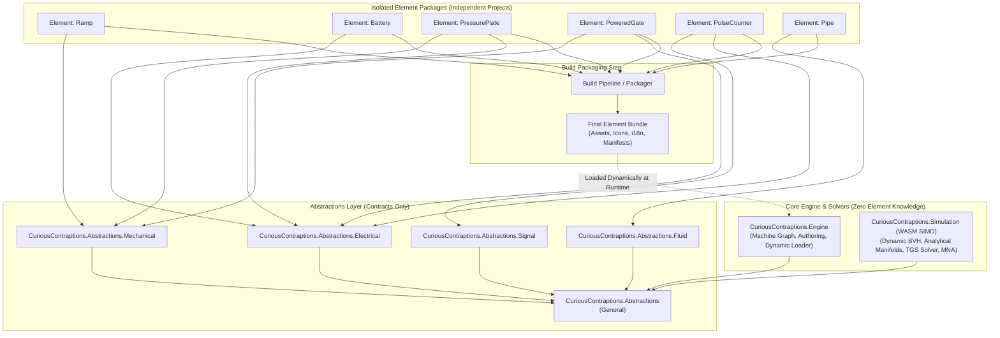

# Architecture Specification: Modular Element Package Isolation & Generic Core Engine

## 1. Core Architectural Mandate

To preserve a truly generic, data-driven simulation engine with zero hardcoded element assumptions, the codebase enforces strict compile-time project isolation:

1. **Zero Engine Knowledge of Puzzle Elements:**
   - The Core Engine (`CuriousContraptions.Engine`, `CuriousContraptions.Simulation`) must have **strictly zero knowledge and zero compile-time dependencies** on any puzzle element.
   - This includes all assets, icons, internationalisation (i18n) strings, element identifiers (`PartId` enum/constants), scene graphs, declarative scripts, and animation bindings.
   - The engine operates purely on generic mathematical and topological models (rigid body mechanics, contact manifolds, constraint equations, MNA circuit graphs, discrete event propagation).

2. **Every Puzzle Element in an Isolated Project:**
   - Every puzzle element lives in its own dedicated project (e.g. `elements/mechanical/ramp/`, `elements/electrical/battery/`, `elements/control/counter/`).
   - Each element project encapsulates all of its own:
     - Metadata & capabilities declaration
     - Visual & collision assets (`.glb`, `.tscn`, materials)
     - Toolbox icon
     - Internationalisation (i18n) strings (title, category, description, tooltips)
     - Declarative cosmetic bindings and animation curves
   - Puzzle element projects **never** reference the Core Engine or sibling element projects.

3. **Strict Abstractions Hierarchy:**
   - Puzzle element projects may **only** reference the Abstractions layer:
     - **`CuriousContraptions.Abstractions` (General):** Base interfaces (`IPartDefinition`, `IWorkshopInstance`, `IPortDeclaration`), extensible identifiers (`PartId`, `SocketId`, `GpuBodyId`), math structs, and serialization contracts.
     - **`CuriousContraptions.Abstractions.Mechanical`:** Kinematic properties, mass, friction, restitution, standard collider definitions, joint and constraint contracts.
     - **`CuriousContraptions.Abstractions.Electrical`:** Circuit node contracts, DC voltage/current sources, switchable contacts, electrical consumer parameters.
     - **`CuriousContraptions.Abstractions.Fluid` (Water):** Flow channels, buoyancy parameters, fluid containment, volumetric passage sensors.
     - **`CuriousContraptions.Abstractions.Signal` (Activation):** Event triggers, pulse counters, clocks, timers, bistable latches.
     - **`CuriousContraptions.Abstractions.Optical`:** Rays, beam emitters, reflectors, optical sensors.
     - **`CuriousContraptions.Abstractions.Pneumatic`:** Air jets, pressure chambers, compression pulses.

4. **Build-Time Compilation & Packaging Pipeline:**
   - At build time, an automated build task inspects each separate puzzle element project, aggregates its metadata, assets, icons, and i18n catalogs, and compiles **one final unified distribution bundle**.
   - The runtime engine loads this bundle dynamically (via dynamic discovery / reflection / manifest parsing).
   - The compiler guarantees that no engineer or AI agent can introduce element-specific logic, switch statements, or hardcoded dimensions into the engine or WASM solver.

5. **Zero Custom JavaScript / Pure C# WASM Compilation:**
   - 100% of game simulation logic, numerical integration, broadphase BVH, narrowphase contact manifold generation, TGS constraint solving, electrical Modified Nodal Analysis (MNA), and discrete activation event propagation must be compiled from C# into WebAssembly (`wasm-simd128`).
   - Strictly zero physics, solver, collision, sensor, or domain logic in JavaScript.
   - The browser Web Worker script (`worker.js`) is strictly a minimal (~50-80 line) platform host shell: importing `dotnet.js`, initializing the runtime (`dotnet.create()`), forwarding `postMessage` envelopes, and binding pointers to the `SharedArrayBuffer` pose ring.

---

## 2. Dependency Graph

---

## 3. Communication Architecture: Lock-Free Ringbuffers, Commands/Queries & Multi-Consumer Event Stream

To enforce strict decoupling across thread boundaries, **workers (Simulation Worker, Animation Worker, Audio Engine, and Main Thread) may ONLY communicate through these three channels:**

1. **Ringbuffers** (Zero-copy `SharedArrayBuffer` ringbuffers for continuous updates and discrete broadcast events)
2. **Commands** (Strongly typed execution requests with verifiable receipts)
3. **Queries** (Read-only state inspection requests)

**Strict Architectural Prohibition:** Direct cross-worker heap references, ad-hoc `postMessage` payloads, unstructured event buses, mutable global state, or backchannel sideband communications are **strictly forbidden**. Any attempt to communicate across workers outside of Ringbuffers, Commands, or Queries violates the architectural contract.

| From \ To | Simulation Worker | Animation Worker | Audio Engine | Main Thread (Renderer/UI) |
| :--- | :--- | :--- | :--- | :--- |
| **Main Thread** | Commands & Queries | Commands & Queries | Commands & Queries | — |
| **Simulation Worker** | — | Pose Ring & Event Ring | Event Ring | Pose Ring & Event Ring / Query Receipts |
| **Animation Worker** | *(Forbidden: one-way)* | — | *(Forbidden)* | Animation Pose Ring |
| **Audio Engine** | *(Forbidden: one-way)* | *(Forbidden)* | — | Audio Status / Telemetry |

### 3.1 Continuous Data Updates (State & Pose Ringbuffer)
- High-rate continuous physical state (rigid body translations, rotations, velocities) streams strictly via a lock-free, zero-copy `SharedArrayBuffer` multi-buffered ring.
- **Single-Producer, Display-Paced Readers:** The C# WASM simulation worker writes committed poses at 120 Hz using monotonic sequence counters. The browser renderer samples the latest committed bracket using atomic loads without readback stalls or heap allocations.

### 3.2 Structured Commands and Queries (Work Execution)
- Work execution uses explicit Command/Query separation:
  - **Commands:** Strongly typed instructions dispatched to the simulation engine (e.g. `StartSimulation`, `PauseSimulation`, `ResetSimulation`, `ConfigureParameters`). Commands are validated at the domain boundary and return explicit execution receipts.
  - **Queries:** Deterministic state queries (e.g. `QueryBodyTransform`, `QueryCircuitVoltage`, `QuerySimulationMetrics`) that read from committed memory without side effects.

### 3.3 Discrete Event Ringbuffer (Multi-Consumer Broadcast with Filtering)
- Discrete simulation occurrences (collision impacts, contact threshold pulses, passage sensor crossings, counter reached events, electrical switch state changes) are published to a dedicated **Event Ringbuffer** in shared memory.
- **Infinite Independent Consumers:** Operates on a single-producer, multi-consumer broadcast ringbuffer (Disruptor pattern). The simulation worker advances a global atomic sequence number. Any number of downstream consumers maintain their own independent read cursors:
  - **Animation Worker (60 Hz):** Reads visual triggers, easing cues, and cosmetic pulses.
  - **Audio Engine:** Reads collision impulses, clicks, and motor tones.
  - **UI & Telemetry:** Reads sensor readouts, objective completions, and diagnostics.
- **Consumer-Side Filtering:** Consumers evaluate lightweight predicate filters directly against raw event memory (e.g. `FilterByDomain(Mechanical)`, `FilterByKind(CounterReached)`, `FilterByImpulse(> 0.1 Ns)`), processing only relevant events without intermediate object allocations or channel contention.

### 3.4 Session Clock Ring (Typed Clock Queries)
- Clock time is a query, so it travels on a ringbuffer, not a message: one `SharedArrayBuffer` with one request/reply slot per requester role (Browser, Animation) and one for the Simulation's derivation check, signalled with `Atomics.notify` / `Atomics.waitAsync`. The typed `ClockProbe`/`ClockReply` records (WorkshopClockWire v4) are the query and its receipt. The ring header (layout v3) also carries the derivation epoch and correction the master stamps under and the Simulation heartbeat the Browser's liveness check reads.
- The answering context is a dedicated clock master context that the Simulation worker spawns and owns (Story 9.4b). It does no other work, so solver ticks on the Simulation's event loop can never delay a clock answer. The Simulation worker's own event loop never answers a probe, and no probe travels over a `MessagePort`.
- The Animation worker's owned `MessagePort` to the Simulation carries only the reliable schedule-control envelopes (Prepare/Prepared/Commit/Applied/Abort); any other envelope rejects.

**Current implementation status of 3.3 (Story 9.4b):** the discrete Event Ringbuffer is the target design. The never-written JavaScript scaffold for it (a 65,600-byte buffer allocated by the browser, transferred, header-initialized and exported a writer nobody called) was deleted as dead code; committed occurrences reach consumers through the existing read publications until the ring is delivered by its own story.

---

## 4. Balanced Coupling Governance (coupling.dev)

Story 9.2b and all future architecture decisions are governed by Vlad Khononov's **Balanced Coupling** model ([coupling.dev](https://coupling.dev)):

### 4.1 The Three Dimensions
1. **Integration Strength (Shared Knowledge):**
   `Intrusive` (private details/implementation) > `Functional` (shared business logic / requirements) > `Model` (domain model) > `Contract` (explicit DTOs / interfaces).
2. **Distance (Cost of Co-Evolution):**
   Method < Object < Module/Namespace < Package/Project < Worker Boundary < System.
3. **Volatility (Probability of Change):**
   Evaluated from the business domain perspective: Core subdomains (high volatility) vs Supporting/Generic subdomains.

### 4.2 The Balance Rule
$$\text{BALANCE} = (\text{STRENGTH} \oplus \text{DISTANCE}) \lor \neg\text{VOLATILITY}$$

Coupling is balanced only when integration strength and distance counterbalance each other, or when volatility is low enough to neutralize the imbalance.

### 4.3 Elimination of Architectural Coupling Imbalances in Curious Contraptions
- **Eliminating High-Distance, High-Strength Imbalance in Worker:**
  The previous `worker.js` suffered from **critical coupling imbalance**: it operated across high distance (browser Web Worker boundary) while exhibiting **Intrusive and Functional Coupling** (ad-hoc checks for part dimensions `hx == 0.9` and duplicating contact sensing rules). Story 9.2b restores balance by eliminating all functional/intrusive logic from the worker, moving all simulation into C# WASM, and restricting the cross-thread boundary strictly to **Contract Coupling** (FlatBuffers fixed-offset layouts, atomic ringbuffer structs).
- **Enforcing Contract Coupling Across Element Boundaries:**
  Because each puzzle element is isolated in its own separate package (high distance), integration with the engine must be strictly **Contract Coupling** through `CuriousContraptions.Abstractions`. Intrusive coupling (inspecting element internals) and functional coupling (sharing business rules) are strictly forbidden by compile-time isolation.
- **Zero Direct Coupling Between Sibling Elements:**
  Distance between separate puzzle element packages is high; their direct integration strength is zero (no inter-element references). Any interaction (collision, electrical circuit, trigger pulse) is mediated exclusively by the engine's generic physical contracts at runtime.
