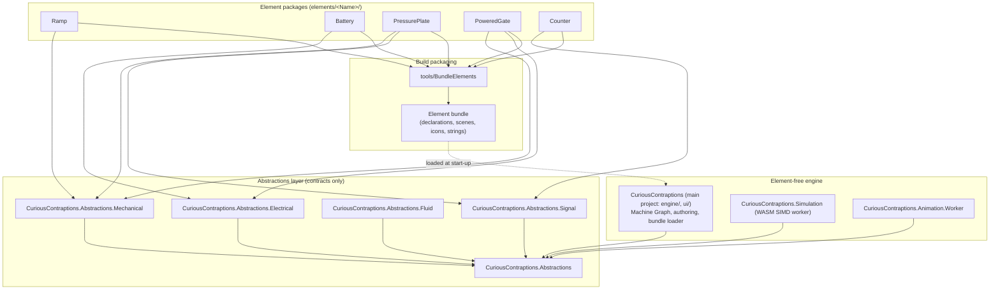

# Sole design authority: element packages, command/query and the event disruptor

This document is the sole design authority for Curious Contraptions (owner rule, 18 Oct 2026, restated 21 Oct 2026). The only permitted design is one isolated project per puzzle element, command/query for every state change and read, and the event disruptor for discrete occurrences. Every other route is legacy and is deleted.

The document has two separate parts:
- **[Target invariants](#target-invariants)** state the design every story builds towards. They describe the target, not the tree.
- **[Current status](#current-status)** is the only place that names where the tree does not yet meet them, with each open finding's owning story. No unmet invariant is described as holding anywhere else.

The [architecture spine](../../_bmad-output/planning-artifacts/architecture.md) (AD-13) and [AGENTS.md](../../AGENTS.md) link here. The [engine contracts](../engine-contracts.md), [general-engine design](../general-engine-design.md) and [f32 physics authority](../gpu-f32-physics.md) apply these invariants to their own subjects.

---

## 1. Target invariants

1. **Project per element.** Each `elements/<Name>/` project is the only declaration of its element: metadata, typed parameter schema, ports, colliders, body and material, domain payloads, events, presentation bindings, icon and scene asset (the element's own Godot `.tscn` scene, owner decision 18 Oct 2026). It references only `CuriousContraptions.Abstractions` and the domain Abstractions it needs (`CuriousContraptions.Abstractions.Mechanical`, `.Electrical`, `.Fluid`, `.Signal`), never the engine or a sibling element. A further domain Abstractions project is added only by the story whose element first needs it.
2. **One declaration source.** `tools/BundleElements` discovers the packages at build time and writes one bundle with one schema. The runtime loads only that bundle. There is no second catalogue, no per-element C# table and no `PartId` named constant. Element identity in saves and messages is the bundle's typed element id.
3. **Command/query.** Every mutation is a typed command through `WorkshopCommandRouter` with a sequence and a receipt. The query side is the published committed read model (`WorkshopRead`), the pose ring and typed queries. Raw `postMessage` flags and console channels are forbidden.
4. **Event disruptor.** One-shot discrete occurrences travel only through the single-producer, multi-consumer event ring, and each consumer has its own cursor. Level states (activation level, latch memory, timer phase, electrical level) are committed-state queries, never ring events and never relayed by main-thread pumps.
5. **Kernels.** Capability-named kernels and `ActivationNodeKind` values selected by declared data are valid. Element-named event kinds such as `CounterReached` and `LatchSet` are not; event kinds name capabilities (for example `ThresholdReached`, `MemoryChanged`).
6. **Forcing function.** The Story 9A.45 build gate enforces these invariants: no element id, element record type, `is`/`PartId` arm or element-named kind outside `elements/`. The early Story 9A.45a ratchet holds a known-violations list that may only shrink, and fails when an entry outlives the story that owns it.

The owner rules below bind every story in the same way:

7. **No fixed capacities.** Every physics, worker, wire and presentation table is sized from the compiled scene at Run; memory is the only bound (owner, 20 Oct 2026; delivered by Story 9R.5b). A fixed count survives only when a written requirement states it, and "historical" is not a justification. Deadlines and durations (for example the 5 s startup qualification or the 250 ms probe lifetime) are time requirements, not table sizes.
8. **No format versioning.** Wire, save, trace and bundle formats carry no version field and no version check; there is one schema per bundle (owner, 21 Oct 2026). Bad input is rejected by structural validation: the FlatBuffers verifier, checked sizes and lengths, defined enum values, finite values within their declared ranges and resolving references. A rejected save is reported to the player and never migrated. Never add or bump a version number.
9. **Delete in the same story.** Each story deletes, in the same story, the old code its new path supersedes (owner, 21 Oct 2026). No mixed old and new path outlives the story that introduces the new one. Each story lists what it deletes, and every deleted symbol returns 0 production hits, checked by `rg` or by the Story 9A.45a ratchet. There are no shims, aliases, dual loaders, fallbacks or migrations; git history is the archive.
10. **Verification tiers.** Every candidate passes the [verification tiers](../../_bmad-output/planning-artifacts/autonomous-development-guide.md#verification-tiers) as that guide states them: Tier 1 on every candidate, Tier 2 on every story, and the Tier 3 full run only for a material engine change or a checkpoint.

### 1.1 Pure C# WASM

All simulation logic, numerical integration, broadphase BVH, narrowphase contact manifolds, TGS constraint solving, electrical supply evaluation and discrete activation propagation compile from C# to WebAssembly (`wasm-simd128`). JavaScript contains no physics, solver, collision, sensor or domain logic. `worker.js` is a platform host: it loads `dotnet.js`, starts the runtime, forwards typed envelopes and copies committed bytes into the shared rings.

### 1.2 Target dependency graph

---

## 2. Communication: rings, commands and queries

Workers (Simulation, Animation, audio and the main thread) communicate only through shared rings, typed commands with receipts, and committed-state queries. Direct cross-worker heap references, ad-hoc `postMessage` payloads, unstructured event buses, mutable global state, console channels and backchannels are forbidden.

| From \ To | Simulation worker | Animation worker | Audio | Main thread (renderer/UI) |
| :--- | :--- | :--- | :--- | :--- |
| **Main thread** | Commands | Commands | Commands | — |
| **Simulation worker** | — | Event ring; committed read | Event ring | Pose ring, event ring, committed read, receipts |
| **Animation worker** | *(forbidden: one-way)* | — | *(forbidden)* | Animation output |
| **Audio** | *(forbidden: one-way)* | *(forbidden)* | — | Status |

### 2.1 Pose ring (continuous state)
Committed body poses stream through a lock-free `SharedArrayBuffer` triple-buffered ring with monotonic sequence counters. The Simulation worker writes committed poses at 120 Hz; the renderer samples the latest committed bracket with atomic loads, without readback stalls or heap allocation. The ring is sized from the compiled scene (invariant 7).

### 2.2 Commands and queries
- **Commands** are typed (`WorkshopCommandKind`), sequence-checked by `WorkshopCommandRouter`, validated at the domain boundary and answered with a receipt.
- **Queries** read committed state without side effects: the published read model (`WorkshopRead`), the pose ring, and typed queries on the same transport.

### 2.3 Event ring (one-shot occurrences)
One-shot occurrences (impacts, passage crossings, threshold reached, memory changed, supply switched) are published once at their commit point to a single-producer, multi-consumer ring (Disruptor pattern). The producer advances a global sequence; each consumer (Animation worker, audio, UI) keeps its own cursor and filters raw records by domain, capability kind or magnitude without allocation. Level states are never ring events; consumers read them from committed state.

### 2.4 Session clock ring (typed clock queries)
Clock time is a query and travels on a ring, not a message: one `SharedArrayBuffer` with one request/reply slot per requester role (Browser, Animation) and one for the Simulation's derivation check, signalled with `Atomics.notify` / `Atomics.waitAsync`. The typed `ClockProbe`/`ClockReply` records are the query and its receipt; the ring header also carries the derivation epoch and correction the master stamps under and the Simulation heartbeat that the Browser's liveness check reads. The answering context is a dedicated clock master context (`clock-master.js`) that the Simulation worker spawns and owns (Story 9.4b); the Simulation's own event loop never answers a probe. The Animation worker's owned `MessagePort` to the Simulation carries only the reliable schedule-control envelopes (Prepare/Prepared/Commit/Applied/Abort).

---

## 3. Balanced coupling (coupling.dev)

Architecture decisions are governed by Vlad Khononov's **Balanced Coupling** model ([coupling.dev](https://coupling.dev)).

1. **Integration strength:** Intrusive > Functional > Model > Contract.
2. **Distance:** Method < Object < Module < Project < Worker boundary < System.
3. **Volatility:** core subdomains change often; supporting and generic subdomains change rarely.

$$\text{BALANCE} = (\text{STRENGTH} \oplus \text{DISTANCE}) \lor \neg\text{VOLATILITY}$$

- **Worker boundary.** The boundary is high distance, so it carries only contract coupling: FlatBuffers schemas and atomic ring layouts. `worker.js` holds no element dimensions and no sensing rules.
- **Element boundary.** Each element package is high distance from the engine, so integration is contract coupling through the Abstractions only. Intrusive and functional coupling are forbidden.
- **Sibling elements.** Elements never reference each other. Every interaction (contact, supply, trigger) is mediated by the engine's generic capabilities at run time.

---

## 4. Current status (at the merge of main `7d6dc38a`, 21 Oct 2026)

The tree does not yet meet the target invariants. Each row is an open finding from the [conformance audit of 18 Oct 2026](../../_bmad-output/planning-artifacts/architecture-conformance-audit-2026-10-18.md) (§8 mapping) or a later owner rule, with its owner under the [21 Oct 2026 delivery order](../../_bmad-output/planning-artifacts/epics.md#delivery-order-coordinator-21-oct-2026-owner-authorised-re-examination). A row leaves this table only when its owning story's terminal review passes. "C-*" names a family conversion story.

### 4.1 Open findings

| Finding | What the tree does today | Breaks invariant | Owner |
| --- | --- | --- | --- |
| A13 (runtime), A17, A18 | `engine/PartRegistry.cs` loads the `.tres` catalogue (`parts/catalog/*.tres`, scenes in `parts/scenes/`), not the bundle; Tennis and Balloon are offered but not constructible | 2 | 9A.14 (with 9A.18 icons merged) |
| A15 | Nine delivered elements have no package: `basket`, `bowling`, `delay`, `funnel`, `pipe`, `pipe_bend_45`, `pipe_bend_90`, `spring`, `switch` | 1 | PKG-1, PKG-2, PKG-3 |
| A2 | `engine/PartId.cs` holds named constants and numeric id switches that are the save/wire identity | 2 | 9A.15 (numeric switches); 9A.45a then 9A.45 (constants) |
| A3 (colliders), B2 | `WorkshopCanonicalColliders` tables and `?? WorkshopCanonicalColliders.For(...)` fallbacks | 1, 2, 9 | 9A.16 |
| A3 (ports, footprints) | The `WorkshopPorts.For` switch table; the runtime does not yet read the footprints the packages declare (`WorkbenchFootprint.Of` was deleted by Story 9R.5b) | 1, 2 | 9A.17 |
| A3 (icons) | `ui/WorkshopIcons.cs` per-element arms | 1, 2 | 9A.14 |
| A3 (decode arms, `CaptureInstance`), A5, A6, A11 | Per-element records, factories, type-pattern dispatch in the compilers and per-element UI panels | 1, 5 | 9A.27 (Wall), then 9.5a, C-Switch, C-Ramp+Receiver, C-Balls, C-Bumper+Spring, C-Gate, 9A.39 (Battery), C-Lamp+Detector, 9A.32 (Domino), C-Plate, C-Clock, C-Memory |
| A4, A10 | `MachinePart.BuildDeclarative` per-element presentation arms and `CosmeticCurves.*` per-element curves in the engine | 1 | 9A.25a (committed-state bindings), 9A.25b (one-shot bindings, with 9A.23) |
| A7 | The solver recognises the gate by joint limit `1.55` and `ActuatorSliderDrive` | 5 | C-Gate (9A.19); C-Plate (9A.20) for the plate |
| A9 | The Simulation warmup builds Battery, PressurePlate and PoweredGate records | 1 | C-Gate (9A.21) |
| A12, A19 | Lessons and level content are C# (`SpringboardLessons`, `WallAndBumper`, closed `WorkshopPuzzleId`) | 1 | 9A.26 |
| A1 | `CuriousContraptions.Simulation` and `CuriousContraptions.Animation.Worker` compile `../engine/gpu/*.cs` and `engine/PartId.cs` wholesale | 1, 6 | 9A.45a (ratchet), 9A.45 (gate) |
| A16 | `SimulationEventKind.CounterReached` and `LatchSet` are element-named | 5 | 9A.22 |
| D1 | The event ring has no runtime producer | 4 | 9A.22 |
| D2, D3 | The event ring has no runtime consumer; occurrences ride in reliable reads and main-thread pumps relay them | 3, 4 | 9A.23 + 9A.25b |
| C2, C3 | `worker.js` accepts a raw `reliableStalled` flag and a raw `memoryRequest` channel outside the router | 3 | 9A.3 |
| C4, C5 | `CCGPU` and `CCGOAL_SOLVED` console lines and `globalThis.WorkshopPoseRing`/`WorkshopAnimation` test hooks | 3 | 9A.24 |
| B1 | `WorkshopCommandRouter` and `BrowserWorkshopClient` fall back to the legacy `WorkshopWire.Decode*` codec | 3, 9 | 9A.2 |
| B6 | `System.Half` binary16 lanes remain in production code (about 850 tokens) | f32 authority | 9A.44 (9.5a moves the timer lane first) |
| MNA | No Modified Nodal Analysis exists (`git grep -i 'nodal\|MNA'` finds no code). The electrical model is compiled supply routes over a reachability graph (`engine/gpu/SupplyRoute.cs`, `WorkshopPhysicsCompiler` routes) | — (not a violation) | MNA is a named later capability, delivered by the first element story that needs it |

### 4.2 Closed since the audit

| Finding | Closed by |
| --- | --- |
| A8: the solver read the authoring graph at tick time | Story 9.4: compiled `SupplyRoute` table at Run |
| A14: `elements/*`, the domain Abstractions and `tools/BundleElements` were not in the solution | `CuriousContraptions.slnx` lists them |
| A13 (build), G10: `tools/BundleElements` hand-listed 13 declarations, wrote a lossy tracked bundle (empty vectors) with a `GeneratedAt` field, and was not a build target | Story 9A.4: packages are discovered by glob and validated, and the lossless bundle is a git-ignored build output of every solution build and web publish (`BundleRoundTripTests`, `BundleCatalogueParityTests`) |
| D4 (JS producer): `writeEventRing` and the never-written JS ring scaffold | Story 9.4b |
| B3: the JS-boundary exports (`AllocateElectrical` … `AbiOffsets`) in `CuriousContraptions.Simulation/Program.cs` | Gone from the tree (`rg` returns 0) |
| B4: the dead `worker.js` layout constants | Story 9.4b; the constants that remain are pinned and used (`WorkerAbiTests`) |
| B5: `tools/workshop-rigid-body.test.mjs`, its README reference and the `workshop-observation` EarlyLoss case | Gone from the tree |
| B8 (directory), A17 dead skips: `scratch/` and the "unmigrated legacy" skips in `PartRegistry` | Gone from the tree |
| Fixed table capacities | Story 9R.5b (findings filed to Story F.8) |
| B7, B8 (remainder): the `MachinePart.Build()` subclassing hook, its only override (the test `ProbePart`) and the orphan root `scratch_test.cs.uid` | Story 9A.1: `MachinePart` is sealed and composes `CosmeticBindingSet`, whose rules are tested directly |
| The remaining format versions (owner, 21 Oct 2026): the clock, memory, schedule, animation channel, physics state, canonical body and trace versions; the trace timing version; the clock ring layout version; the isolation policy number; the bundle and WireContract fixture versions | Story 9A.1, with F.10 merged. A former version word is zero padding that rejects when set; `WorkshopFormatTests.NoProductionSourceNamesAFormatVersion` fails on any re-added version |
| Format versions of the Workshop wire, the construction save and the cadence settings (`WorkshopWireVersion`, `WorkshopSaveVersion`, `WorkshopSettingsVersion`) | Story 9R.7 |

### 4.3 The unsupported 9.2b Pass (G8)

[review-9-2b](../../_bmad-output/implementation-artifacts/review-9-2b-modular-isolation.md) records PASS for AC1, AC3, AC4 and AC5. The tree does not support those verdicts: findings A2–A13 and D1/D2 above contradict them. In particular:
- **The MNA clause.** No Modified Nodal Analysis exists; the electrical domain is graph reachability with compiled supply routes.
- **The "~50–80 line `worker.js`" clause.** `worker.js` is 379 lines at `c7d5dbb0` (347 at the audit). It holds no solver code, but it is not the minimal shell the review claimed.

The review file is historical evidence and is not edited. Story 9A.0's terminal review appends its dated addendum; Story 9.2b closes with the final 9A.45.
