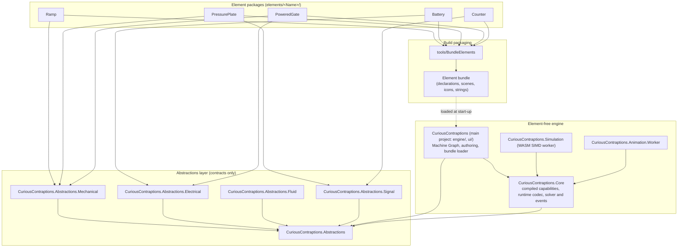

# Sole design authority: element packages, command/query and the event disruptor

**Acceptance policy — owner, 28 October 2026:** apply the [game-fidelity policy](../delivery-workflow.md#game-fidelity) and [testing guidance](../testing-guidance.md) to every criterion below. Preserve gameplay outcomes, meaningful causal order, stability and lifecycle. Historical tick/ordinal/trajectory or migration-era pose matching is not acceptance; numerical precision needs a gameplay or defined-interface justification. Exact authored data, typed ownership and deliberate timing features retain their contracts. Replay is checked through decoded semantic behaviour, never simulation-output hashes or whole-buffer identity. This supersedes conflicting older acceptance wording without removing requirement identities or intended element behaviour.

This document is the sole design authority for Curious Contraptions (owner rule, 18 Oct 2026, restated 21 Oct 2026). The only permitted design is one isolated project per puzzle element, command/query for every state change and read, and the event disruptor for discrete occurrences. Every other route is legacy and is deleted.

The document has two separate parts:
- **[Target invariants](#target-invariants)** state the design every story builds towards. They describe the target, not the tree.
- **[Current status](#current-status)** is the only place that names where the tree does not yet meet them, with each open finding's owning story. No unmet invariant is described as holding anywhere else.

The [architecture spine](../../_bmad-output/planning-artifacts/architecture.md) (AD-13) and [AGENTS.md](../../AGENTS.md) link here. The [engine contracts](../engine-contracts.md), [general-engine design](../general-engine-design.md) and [f32 physics authority](../gpu-f32-physics.md) apply these invariants to their own subjects.

---

## 1. Target invariants

1. **Project per element.** Each `elements/<Name>/` project is the only declaration of its element: metadata, typed parameter schema, ports, colliders, body and material, domain payloads, events, presentation bindings, icon and scene asset (the element's own Godot `.tscn` scene, owner decision 18 Oct 2026). It references only `CuriousContraptions.Abstractions` and the domain Abstractions it needs (`CuriousContraptions.Abstractions.Mechanical`, `.Electrical`, `.Fluid`, `.Signal`), never the engine or a sibling element. A further domain Abstractions project is added only by the story whose element first needs it.
2. **One declaration source.** `tools/BundleElements` discovers the packages at build time and writes one bundle with one schema. The runtime loads only that bundle. There is no second catalogue, no per-element C# table and no `PartId` named constant. Element identity in saves and messages is the bundle's typed element id.
3. **Command/query.** Every mutation is a typed command through `WorkshopCommandRouter` with a sequence and a receipt. The query side is the published committed read model (`WorkshopRead`), the pose ring and typed queries. Raw `postMessage` flags and console channels are forbidden.
4. **Event disruptor.** One-shot discrete occurrences travel only through the single-producer, multi-consumer event ring, and each consumer has its own cursor. Level states (activation level, latch memory, timer phase, electrical level) are committed-state queries, never ring events and never relayed by main-thread pumps.
5. **Kernels.** Capability-named kernels and `ActivationNodeKind` values selected by declared data are valid. Element-named event kinds such as `CounterReached` and `LatchSet` are not; event kinds name capabilities (for example `ThresholdReached`, `MemoryChanged`).
6. **Forcing function.** The Story 9A.45 build gate enforces these invariants: no element id, element record type, `is`/`PartId` arm or element-named kind outside `elements/`. The early Story 9A.45a ratchet was an intermediate migration gate. The final gate has no known-violation or per-occurrence exception ledger; it derives package identities from the generated bundle and distinguishes generic capability names from package-specific dispatch.

The owner rules below bind every story in the same way:

7. **No fixed capacities.** Declared physics, worker, wire and presentation tables retain actual logical scene counts; mutable backing storage starts at common category defaults and grows geometrically at watermarks. Interaction state remains logically sparse. No worst-case owner×target state reservation or arbitrary population ceiling is allowed (latest owner amendment27 Oct2026; default/watermark implementation in [compound/demand-sizing spec](../../_bmad-output/implementation-artifacts/spec-engine-multi-collider-dynamic.md#actual-demand-sizing-and-sparse-interaction-ownership--owner-amendment) published at `28a2d302e6c0e1a0e361bfe62beea9b332d6b9f9`; browser/performance qualification pending). Memory and checked representation are the only bounds. A fixed count survives only when a written requirement states it, and "historical" is not a justification. Deadlines and durations (for example the 5 s startup qualification or the 250 ms probe lifetime) are time requirements, not table sizes.
8. **No format versioning.** Wire, save, trace and bundle formats carry no version field and no version check; there is one schema per bundle (owner, 21 Oct 2026). Bad input is rejected by structural validation: the FlatBuffers verifier, checked sizes and lengths, defined enum values, finite values within their declared ranges and resolving references. A rejected save is reported to the player and never migrated. Never add or bump a version number.
9. **Delete in the same story.** Each story deletes, in the same story, the old code its new path supersedes (owner, 21 Oct 2026). No mixed old and new path outlives the story that introduces the new one. Each story lists what it deletes, and every deleted symbol returns 0 production hits, checked by `rg` or by the Story 9A.45a ratchet. There are no shims, aliases, dual loaders, fallbacks or migrations; git history is the archive.
10. **Verification.** Follow the owner's [local verification authority](../delivery-workflow.md#local-test-authority): affected native/compiled-TypeScript checks during implementation, one complete local solution round and normal hooks before publication, with independent Auto review. Reuse applicable passing proof. Browser qualification remains at the post-catalogue gate; CI monitoring does not block continuation.

### 1.1 Pure C# WASM

All simulation logic, numerical integration, broadphase BVH, narrowphase contact manifolds, TGS constraint solving, electrical supply evaluation and discrete activation propagation compile from C# to WebAssembly (`wasm-simd128`). JavaScript contains no physics, solver, collision, sensor or domain logic. `worker.js` is a platform host: it loads `dotnet.js`, starts the runtime, forwards typed envelopes and copies committed bytes into the shared rings.

### 1.2 Target dependency graph

---

## 2. Communication: rings, commands and queries

Workers (Simulation, Animation, audio and the main thread) communicate only through shared rings, typed commands with receipts, and committed-state queries. Direct cross-worker heap references, ad-hoc `postMessage` payloads, unstructured event buses, mutable global state, console channels and backchannels are forbidden.

| From \ To | Simulation worker | Animation worker | Audio | Main thread (renderer/UI) |
| :--- | :--- | :--- | :--- | :--- |
| **Main thread** | Commands | Commands | Commands | — |
| **Simulation worker** | — | Event ring; committed read | Event ring | Pose ring, event ring, committed read, receipts |
| **Animation worker** | *(forbidden: one-way)* | — | *(forbidden)* | Animation output |
| **Audio** | *(forbidden: one-way)* | *(forbidden)* | — | Status |

### 2.1 Pose ring (continuous state)
Committed body poses stream through a lock-free `SharedArrayBuffer` triple-buffered ring with monotonic sequence counters. The Simulation worker writes committed poses at 120 Hz; the renderer samples the latest committed bracket with atomic loads, without readback stalls or heap allocation. Bootstrap reserves16 body records per slot; installation prepares default-or-needed geometric capacity before epoch commit. Same-epoch topology is fixed and reuses storage; spare records are zero. Exact logical populations remain the authority (invariant7).

### 2.2 Commands and queries
- **Commands** are typed (`WorkshopCommandKind`), sequence-checked by `WorkshopCommandRouter`, validated at the domain boundary and answered with a receipt.
- **Queries** read committed state without side effects: the published read model (`WorkshopRead`), the pose ring, and typed queries on the same transport.

### 2.3 Event ring (one-shot occurrences)
One-shot occurrences (impacts, passage crossings, captures, contact-load edges, signal triggers, threshold reached, memory changed, supply switched) are published once at their commit point to a single-producer, multi-consumer ring (Disruptor pattern). The producer advances a global sequence; each consumer (Animation worker, audio, UI) keeps its own cursor and filters raw records by domain, capability kind or magnitude without allocation. Level states are never ring events; consumers read them from committed state.

The current event contract is the owner's27 October actual-demand amendment, published at `28a2d302e6c0e1a0e361bfe62beea9b332d6b9f9`; implementation and verification are recorded in the [compound/demand-sizing spec](../../_bmad-output/implementation-artifacts/spec-engine-multi-collider-dynamic.md#actual-demand-sizing-and-sparse-interaction-ownership--owner-amendment). The64-byte header/records and single producer/multiple independent cursors remain. Start at32 slots and grow at the75% prospective-demand watermark from actual records in the existing0.5s retention horizon plus pending publication, not compiled-producer worst case. Reserve outbox/native/shared-buffer storage before joint world/event commit. Growth copies surviving history, preserves sequence and same-epoch consumer cursors, and is advertised only after preparation; discarded/failed candidates publish nothing. New epoch resets sequence/cursors. Ordinary slow-reader lapping outside retained history stays explicit, but growth or bursts cannot silently truncate events. Capacity normally doubles in one reserve (bulk demand jumps directly to sufficient headroom), and grows monotonically within an epoch and serves as its resize generation. Every positive representable capacity is valid; slots use modulo indexing, with geometric growth and demand-triggered saturation at the actual storage bound. Header bytes24–63 are reserved zero: producer-loss counters are deleted, while each consumer retains its skipped/lapped count.

The Simulation worker posts a prepared replacement to browser and Animation readers before later read messages. One shared reader remains transport-only and uses atomic slot seqlocks; it preserves cursor on same-epoch growth, refuses stale smaller replacement, and waits for matching admitted epoch. C# decodes delivery and filters owner/kind. EventRingMemory alone owns shared views; the C# memory implementation follows the same history/growth contract. Touched worker/cursor glue is converted to strict TypeScript and compiled into existing shipped JS paths. The published event path deleted fixed producer sizing, burst truncation and unconditional same-epoch cursor reset. Its full local and independent publication receipt is in that spec. The published Core split preserves this behavior; browser/performance qualification remains pending.

Unchanged consumer obligations: the Animation worker reads at the start of Service and evaluates cues from each record's physical time; main-thread goal wake holds a notification until the matching committed tick. Consumers never block or fault simulation, and lost cues outside retained history are not replayed. Only EventRingMemory may construct or access shared views; every payload/sequence accessor uses atomic whole-word loads/stores, and the reader checks sequence before and after payload copying. A newer epoch waits for its matching committed state, and an older epoch is ignored. Growth changes sizing and same-epoch attachment, not these timing, ownership or seqlock rules.

### 2.4 Session clock ring (typed clock queries)
Clock time is a query and travels on a ring, not a message: one `SharedArrayBuffer` with one request/reply slot per requester role (Browser, Animation) and one for the Simulation's derivation check, signalled with `Atomics.notify` / `Atomics.waitAsync`. The typed `ClockProbe`/`ClockReply` records are the query and its receipt; the ring header also carries the derivation epoch and correction the master stamps under and the Simulation heartbeat that the Browser's liveness check reads. The answering context is a dedicated clock master context (`clock-master.js`) that the Simulation worker spawns and owns (Story 9.4b); the Simulation's own event loop never answers a probe. The Animation worker's owned `MessagePort` to the Simulation carries only the reliable schedule-control envelopes (Prepare/Prepared/Commit/Applied/Abort), the committed reads and each new event ring buffer (Story 9A.23).

---

## 3. Balanced coupling (coupling.dev)

Architecture decisions are governed by Vlad Khononov's **Balanced Coupling** model ([coupling.dev](https://coupling.dev)).

1. **Integration strength:** Intrusive > Functional > Model > Contract.
2. **Distance:** Method < Object < Module < Project < Worker boundary < System.
3. **Volatility:** core subdomains change often; supporting and generic subdomains change rarely.

$$\text{BALANCE} = (\text{STRENGTH} \oplus \text{DISTANCE}) \lor \neg\text{VOLATILITY}$$

- **Worker boundary.** The boundary is high distance, so it carries only contract coupling: FlatBuffers schemas and atomic ring layouts. `worker.js` holds no element dimensions and no sensing rules.
- **Element boundary.** Each element package is high distance from the engine, so integration is contract coupling through the Abstractions only. Intrusive and functional coupling are forbidden.
- **Sibling elements.** Elements never reference each other. Every interaction (contact, supply, trigger) is mediated by the engine's generic capabilities at run time.

---

## 4. Current status — 30 October 2026

This view records published main `71135ecd0109b8d5eba0a9f4b944e2ffbefceedd` and the [9A.45 publication receipt](../../_bmad-output/implementation-artifacts/spec-9a-45-element-isolation.md#publication-receipt--30-october-2026): complete local verification 5,057/0/0, normal hooks 127/0/0, five Auto layers, exact-SHA approval and remote-main verification passed. The 10.2b rope candidate remains subject to its own independent review. CI/deployment and browser/release qualification remain unverified.

### 4.1 Implementation findings

No unresolved implementation isolation finding remains after build/dependency guards and independent review. Seven accepted findings were repaired, including conditional-source scanning, compiled presentation admission and delayed Run capture ownership; see the spec's Auto Run Result. New findings reopen the affected row; no acceptance is waived by this document.

| Finding | Current implementation and evidence | Owner / acceptance |
| --- | --- | --- |
| A1 | Both workers reference `CuriousContraptions.Core`; the wholesale engine and PartId links, bundle loader references and embedded bundle/lesson resources are removed. Core's explicit source inventory owns generic runtime code. Main compiles physics, activation, presentation and permissions into one typed installation; runtime and authoring schema ownership are separate. | published 9A.45; dependency/codec/lifecycle proof and independent review passed; receipt above |
| A2 | PartId is an opaque typed value without named element members. Main-owned authoring/save boundaries use declared bundle identities; Core receives compiled capabilities, not element ids or authoring data. | 9A.15 [review](../../_bmad-output/implementation-artifacts/review-9a-15-bundle-element-id-save-wire.md); final named-member removal in published 9A.45 |
| A3 (colliders), B2, A3 (footprints) | Body, collider, material and footprint data come from package declarations through the shared main compiler. The canonical collider table and fallback are absent. Core validates and executes the compiled rows. | 9A.16 [terminal review](../../_bmad-output/implementation-artifacts/review-9a-16-bundle-only-colliders.md); 9A.45 preserves the boundary |
| A3 (ports) | ElementPortCatalogue reads declared ports on main. Generic typed sockets and compiled activation/supply topology cross the runtime boundary; workers do not load a port catalogue. | 9A.17 [review](../../_bmad-output/implementation-artifacts/review-9a-17-bundle-ports-and-footprint.md); worker cutover in published 9A.45 |
| A3 (decode/CaptureInstance), A5, A6, A11 | Generic instances and declared parameters replace element records and UI/compiler/codec arms. The last straight-Pipe record, length field, convenience factories and special capture/snap/save branches are removed. Its existing package still owns the shell, collars, mouth positions and length limits. | Family conversions through C-Memory; final Pipe closure in published 9A.45, native behavior and independent review passed; published; receipt above |
| A4, A10 | Packages declare presentation bindings. Main compiles target mappings; the Animation runtime evaluates generic compiled tracks and committed levels/events. Element curve classes and main-thread one-shot pumps are absent. Unused TimerObservation transport is removed; live declared timer presentation remains. | 9A.25a [review](../../_bmad-output/implementation-artifacts/review-9a-25a-package-presentation.md), 9A.23/25b [terminal receipt](../../_bmad-output/implementation-artifacts/review-9a-23-25b-ring-consumers.md#terminal-publication-verification-independent-reviewer-2026-10-24); published 9A.45 compiled presentation |
| A7 | Generic declared prismatic drives and contact-load capabilities replace the named actuator and element scans. No element-selected kernel is retained. | C-Gate, C-Plate; source preserved through Core ownership |
| A9 | Synthetic startup scenes, warmup and dummy command lifecycles are deleted. Ordinary initialization and solver warm-starting remain. | Published `822317c99a08ec64ce2d7406090036d51c1c8fa2`, [receipt](../../_bmad-output/implementation-artifacts/spec-engine-remove-core-warmup.md#terminal-publication-receipt--26-october-2026) |
| A12, A19 | PuzzleCatalogue reads authored `content/puzzles.json` in the main assembly. No lesson C# dispatch or closed puzzle-id catalogue remains. Generic parameters replace the last scalar lesson representation. | 9A.26 [review](../../_bmad-output/implementation-artifacts/review-9a-26-lessons-content.md); 9A.45 generic-parameter migration |
| A13 (runtime), A17, A18, A3 (icons) | PartRegistry loads the generated bundle only; package scenes/icons supply the palette. Resource catalogue and static palette/element-icon switches are absent. The generated declarations are the sole membership authority; no named undelivered-part blacklist remains. | 9A.14/18 [terminal review](../../_bmad-output/implementation-artifacts/review-9a-14-bundle-sole-catalogue.md); final admission-list deletion in published 9A.45 |
| A15 | Every currently offered element has its own declaration package. Missing future packages are absent from the bundle and refuse as unknown inputs. This does not claim that Tennis, Balloon or the remaining named catalogue is implemented. | Existing PKG deliveries; future elements retain their named delivery owners |
| A16 | Event kinds name capabilities, including ThresholdReached and MemoryChanged. Packages declare event kinds without private payload layouts; element-named event kinds are absent. | 9A.22 [review](../../_bmad-output/implementation-artifacts/review-9a-22-event-ring.md), published `fc7f7cac` |
| D1 | The shared producer stages actual compiled events and sequences them only at commit. Worker glue publishes C#-composed records into the shared ring. | 9A.22; actual-demand amendment below |
| D2, D3 | Independent consumers use the shared reader. Occurrence-carrying reliable reads and main-thread occurrence relays are removed; persistent levels remain committed queries. | 9A.23/25b terminal receipt linked above; 9A.24 observation adds independent readers |
| C2, C3 | Reliable-read stall accounting and memory observation use typed commands/receipts; unknown commands/envelopes refuse. Raw stall flags and memory channels are absent. | 9A.3 [review](../../_bmad-output/implementation-artifacts/review-9a-3-typed-transport-control-commands.md); current transport guards |
| C4, C5 | Session-owned typed receipts, committed queries, diagnostics and independent event cursors replace console/global publishers. Startup and publication failures preserve explicit terminal/incomplete detail. 9A.45 associates runtime capture identity with main-owned authored snapshots. | 9A.24 published `15cf84969870cddefc7c91b6a539d7144dc47f76`, [receipt](../../_bmad-output/implementation-artifacts/spec-9a-24-typed-observation-port.md#publication-receipt--29-october-2026); association behavior verified in published 9A.45 |
| B1 | Typed size-prefixed FlatBuffers owns each boundary. Runtime commands/read/installations use the Core codec; authored constructions/saves use the main-only authoring codec. Each record has one current decoder; malformed inputs refuse without migration. | 9A.2 [review](../../_bmad-output/implementation-artifacts/review-9a-2-single-flatbuffers-codec.md); schema ownership split in published 9A.45 |
| B6 | Game values remain f32; shared integer ordinal/f32-phase time and signed integral clock exchanges replace double game arithmetic. Narrow external adapters retain their correct types. | 9A.44A/B; Part B published `6e0e0ee1799d31211e1769b8883f6bedb3fae396`, [receipt](../../_bmad-output/implementation-artifacts/spec-9a-44b-f32-game-values-and-integer-time.md#terminal-publication-receipt--29-october-2026) |
| Compound/demand sizing | Logical rows and sparse interactions reflect actual scene demand. Mutable backing storage uses category defaults and geometric watermark growth; event growth preserves same-epoch history/cursors without burst truncation. | Published `28a2d302e6c0e1a0e361bfe62beea9b332d6b9f9`, [receipt](../../_bmad-output/implementation-artifacts/spec-engine-multi-collider-dynamic.md#terminal-publication-receipt--28-october-2026); regression preservation required in 9A.45 |

### 4.2 Earlier implementation closures

These audit identities remain traceable; their historical records are not new task prerequisites.

| Finding | Current disposition |
| --- | --- |
| A8 | Solver consumes compiled supply/physics state; authoring compilation stays on main. |
| A14 | Solution includes element packages, domain abstractions, bundle tooling and the new Core project. |
| A13 (build), G10 | BundleElements discovers packages, validates declarations and generates the lossless ignored bundle in normal builds. The published 9A.45 also runs the production isolation scan on unchanged bundle output. |
| D4 (JS producer), B4 | Runtime TypeScript is transport-only; shared ring ownership and current ABI fields replace the obsolete scaffold/layout constants. |
| B3 | The old JS-boundary allocation/layout exports are absent. |
| B5 | The obsolete rigid-body harness and EarlyLoss path are absent; current compiled-output harnesses own behavior proof. |
| B7, B8 | MachinePart is sealed and consumes declared bindings; subclassing hooks, scratch production artifacts and unmigrated-record admission paths are absent. |
| Fixed table capacities | Actual-demand ownership supersedes fixed limits; memory and checked representation are the only storage bounds. |
| Format versions | Wire/save/trace/bundle/ring contracts have one current representation. Reserved padding and structural/enum/range/reference checks reject unsupported inputs without a version branch or migration. |

### 4.3 Retained qualification and historical verdict limits

Browser consumer migration and actual Chrome qualification remain pending until the complete named catalogue passes native proof. Device/performance/retention and release qualification remain at their named gates. CI/build artifacts/deployment for 9A.45 are unverified. Future catalogue capabilities, including MNA when its first consumer requires it, remain owned future work rather than hidden prerequisites or completed features.

The [9.2b review](../../_bmad-output/implementation-artifacts/review-9-2b-modular-isolation.md) is unchanged historical evidence. G8 records that its original broad Pass was unsupported: MNA did not exist and its stated worker-shell size did not match the audited tree. Those historical facts are not rewritten as a current Pass. The present 9A.45 review must establish current isolation criteria independently; it does not retroactively qualify MNA, browser behavior or a historical line-count claim.
